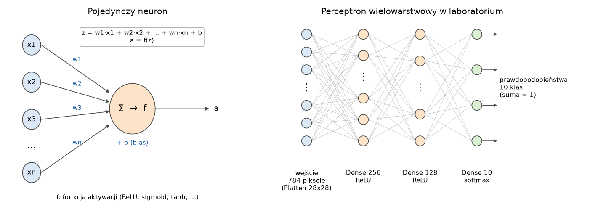
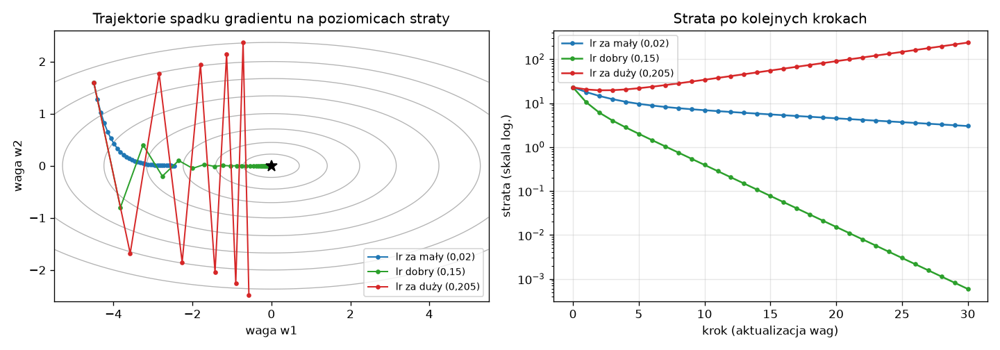
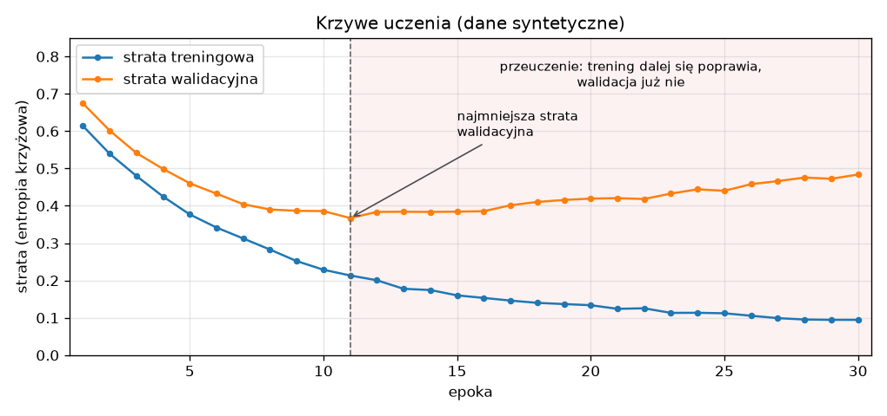
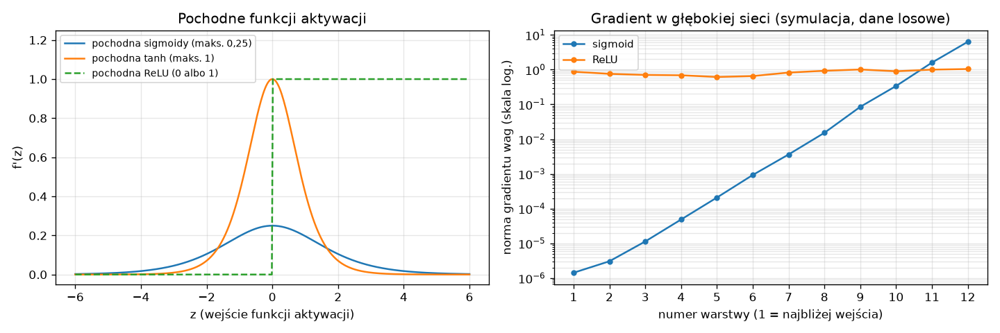

# Laboratorium 1: Perceptron wielowarstwowy i pętla treningowa. Wprowadzenie

Ten tekst przeczytajcie przed zajęciami. Zbiera pojęcia potrzebne we wszystkich zadaniach laboratorium, także rozszerzonych, i łączy je z funkcjami Keras z notebooka. Wyników i odpowiedzi na pytania tu nie ma, ale wyjaśnienia powinny wystarczyć, żeby je samodzielnie uzasadnić.

## Neuron i warstwa Dense

Neuron mnoży każde wejście przez wagę, dodaje wyraz wolny (bias) i przepuszcza wynik przez funkcję aktywacji (activation function):

```
z = w1*x1 + w2*x2 + ... + wn*xn + b
a = f(z)
```

Warstwa `keras.layers.Dense` to wiele neuronów, które widzą te same wejścia, czyli `f(x @ W + b)`. Macierz `W` Keras nazywa jądrem (`kernel`), ma ona kształt (liczba wejść, liczba neuronów), a wektor `b` ma po jednym elemencie na neuron. Każdy element jądra i biasu jest parametrem uczonym w treningu, więc z tych dwóch kształtów policzycie parametry warstwy. `Flatten` tylko zamienia obraz 28x28 w wektor i parametrów nie ma.



## Softmax i entropia krzyżowa

Ostatnia warstwa ma 10 neuronów, po jednym na klasę. Ich surowe wyjścia z1, ..., z10 to logity (logits). Softmax zamienia je na prawdopodobieństwa dodatnie i sumujące się do 1:

```
p_k = exp(z_k) / (exp(z_1) + exp(z_2) + ... + exp(z_10))
```

Przewidziana klasa to ta z największym `p_k` (`argmax`). Strata to entropia krzyżowa (cross-entropy), dla jednego przykładu z prawdziwą klasą y równa minus logarytmowi naturalnemu prawdopodobieństwa tej klasy:

```
L = -ln(p_y)
```

Przy `p_y` bliskim 1 strata jest bliska zera, przy małym `p_y` rośnie bez ograniczenia, więc pewna pomyłka kosztuje dużo więcej niż niepewna. Etykiety w postaci liczb 0 do 9 obsługuje `sparse_categorical_crossentropy` (w pętli `keras.losses.SparseCategoricalCrossentropy`). Wersja bez `sparse` oczekuje kodowania one-hot.

Model, który każdej klasie daje 1/10, ma na każdym przykładzie stratę `-ln(1/10) = ln 10 ≈ 2,303`. Porównując z tą liczbą stratę modelu przed treningiem, zastanówcie się, co zwraca softmax, gdy logity są do siebie zbliżone.

W notebooku softmax jest w modelu, a strata ma domyślne `from_logits=False`. Przewodnik keras.io o własnej pętli robi odwrotnie (model bez softmaksu, strata z `from_logits=True`). Oba warianty są poprawne, ale mieszanie ich kończy się ostrzeżeniem Keras.

## Od regresji softmax do MLP

`Flatten` z jedną warstwą `Dense(10, activation="softmax")` to regresja softmax: każdy logit jest liniową funkcją pikseli. Perceptron wielowarstwowy (multilayer perceptron, MLP) dokłada przed wyjściem warstwy ukryte, tutaj `Dense(256)` i `Dense(128)`. Bez nieliniowej aktywacji nic by to nie dało, bo złożenie przekształceń liniowych jest liniowe:

```
W2 @ (W1 @ x + b1) + b2 = (W2 @ W1) @ x + (W2 @ b1 + b2)
```

Dopiero funkcja taka jak ReLU, `max(0, z)`, wstawiona między warstwy pozwala sieci budować cechy, których pojedyncza warstwa liniowa nie wyrazi.

## Spadek gradientu, batch, epoka i krok

Gradient straty wskazuje kierunek, w którym strata rośnie najszybciej, więc spadek gradientu (gradient descent) przesuwa wagi w przeciwną stronę:

```
w := w - lr * dL/dw
```

Learning rate (`lr`, współczynnik uczenia) ustala długość kroku. Gradient liczy się na mini-batchu, losowej paczce przykładów (w notebooku `BATCH = 128`). Jedna aktualizacja wag po jednym batchu to krok (step), a epoka to przejście przez cały zbiór treningowy:

```
kroki na epokę = sufit(liczba przykładów treningowych / rozmiar batcha)
```

Przy tej samej liczbie epok mniejszy batch daje więcej aktualizacji, każdą z bardziej zaszumionym gradientem. Większy batch lepiej wykorzystuje GPU, ale kroków jest mniej. Porównując rozmiary batcha, patrzcie więc także na liczbę kroków.



Na rysunku dolina straty jest wydłużona. Przy małym learning rate wagi pełzną w stronę minimum. Przy dobrze dobranym szybko schodzą na dno. Za duży sprawia, że każdy krok przeskakuje dno i ląduje wyżej, a strata rośnie. W sieci widać to jako stratę, która skacze, stoi wysoko albo zamienia się w `nan`.

## Adam

Zwykły SGD (stochastic gradient descent, `keras.optimizers.SGD`) używa jednego kroku dla wszystkich wag. Adam prowadzi dla każdej wagi średnie kroczące gradientu i jego kwadratu:

```
m := beta1 * m + (1 - beta1) * g
v := beta2 * v + (1 - beta2) * g^2
w := w - lr * m_hat / (sqrt(v_hat) + epsilon)
```

`m_hat` i `v_hat` są skorygowane o to, że średnie startują od zera. Domyślnie `keras.optimizers.Adam` ma `learning_rate=0.001`, `beta_1=0.9`, `beta_2=0.999`, `epsilon=1e-07`. Dzielenie przez pierwiastek z `v` normalizuje wielkość gradientu, więc nawet waga ze stale małymi gradientami robi kroki rzędu `lr`. Zapamiętajcie to przed zadaniem o inicjalizacji wag.

## Propagacja wsteczna i własna pętla treningowa

Gradienty względem wszystkich wag liczy propagacja wsteczna (backpropagation): reguła łańcuchowa stosowana od straty w stronę wejścia. Pochodna dla wczesnej warstwy jest iloczynem czynników ze wszystkich warstw nad nią, do czego wrócimy przy zanikającym gradiencie. W zadaniu 4 zapiszecie jawnie to, co `fit` robi w każdym kroku:

```
with tf.GradientTape() as tasma:
    y_pred = model(x, training=True)        # przejście w przód (forward pass)
    strata = funkcja_straty(y, y_pred)
gradienty = tasma.gradient(strata, model.trainable_weights)
optymalizator.apply_gradients(zip(gradienty, model.trainable_weights))
```

`tf.GradientTape` zapisuje w bloku `with` operacje na zmiennych trenowalnych, a `tasma.gradient` przechodzi je od końca i zwraca gradienty w kolejności listy wag. Taśma wag nie zmienia. Robi to optymalizator: `apply_gradients` dostaje pary (gradient, zmienna), wylicza krok według swojej reguły i aktualizuje zmienne. `training=True` mówi warstwom, że trwa trening, bo część z nich, na przykład `Dropout` i `BatchNormalization`, działa wtedy inaczej.

Metryki `keras.metrics.Mean` i `keras.metrics.SparseCategoricalAccuracy` mają stan: zbierają wartości przez `update_state`, zwracają wynik przez `result()` i na początku epoki trzeba je wyzerować (`reset_state()`). `tf.GradientTape`, `tf.data` i `tf.function` działają tylko na backendzie TensorFlow, natomiast model, optymalizator, strata i metryki są wspólne dla wszystkich backendów Keras 3.

## tf.function i graf obliczeń

Domyślnie TensorFlow wykonuje operacje od razu, jedna po drugiej, pod kontrolą interpretera Pythona (tryb eager). `tf.function` przy pierwszym wywołaniu śledzi (trace) funkcję i zapisuje jej operacje jako graf obliczeń. Kolejne wywołania z danymi tego samego kształtu i typu uruchamiają gotowy graf, bez Pythona. Dlatego zwykły `print` w takiej funkcji wykona się tylko raz, w czasie śledzenia, a `tf.print` przy każdym wywołaniu.

## Funkcje aktywacji i nasycenie

Sigmoida `1 / (1 + exp(-z))` i `tanh(z)` nasycają się (saturation): dla dużych |z| wykres jest prawie płaski, pochodna bliska zera i przez neuron płynie mały gradient. Pochodna sigmoidy nie przekracza 0,25, a jej wyjścia są zawsze dodatnie. Tanh ma w zerze pochodną 1 i wyjścia symetryczne wokół zera. ReLU ma pochodną 1 dla dodatnich z i 0 dla ujemnych, więc po stronie dodatniej się nie nasyca. Pochodne wszystkich trzech pokazuje lewy panel rysunku w sekcji o zanikającym gradiencie.

## Krzywe uczenia i przeuczenie

`History` z `fit` przechowuje stratę i dokładność z każdej epoki dla treningu i walidacji, a `rysuj_krzywe` rysuje je obok siebie. Na początku obie straty spadają razem. Gdy model zaczyna uczyć się szczegółów zbioru treningowego, które nie powtarzają się w nowych danych, strata treningowa dalej maleje, a walidacyjna staje albo rośnie. To przeuczenie (overfitting). Model o za małej pojemności daje inny obraz: obie krzywe szybko się wypłaszczają i leżą blisko siebie.



Dokładność zależy tylko od tego, która klasa wygrywa, a entropia krzyżowa od wartości `p_y` i mocno karze pewne pomyłki. Obie miary mogą więc w tej samej epoce iść w różne strony. Wybierając epokę dla modelu końcowego, zdecydujcie, którą z nich się kierujecie.

Inicjalizacja, kolejność batchy i obliczenia na GPU wprowadzają rozrzut nawet przy tym samym ziarnie. Stąd `keras.utils.set_random_seed(RANDOM_STATE)` przed każdym modelem i zmiana jednego parametru naraz. Zanim uznacie różnicę dwóch przebiegów za efekt parametru, oszacujcie, ile mogłyby się różnić dwa przebiegi tej samej konfiguracji.

## Podział na trening, walidację i test

Na zbiorze treningowym uczą się wagi. Walidacyjny (10% treningu, wydzielone ze `stratify`, by zachować proporcje klas) służy do decyzji: epoki, learning rate, architektury. Testowy daje ocenę na danych, które na żadną decyzję nie wpłynęły. Każda zmiana modelu po obejrzeniu wyniku wykorzystuje informację z tego zbioru, więc test oglądany wielokrotnie staje się kolejną walidacją. Piksele skaluje się z 0 do 255 do przedziału [0, 1] jako `float32`. Pomyślcie, jakie wartości `z` dostałaby pierwsza warstwa przy wagach rzędu setnych i wejściach rzędu setek.

## Macierz pomyłek i pewność błędnych predykcji

W macierzy pomyłek (`sklearn.metrics.confusion_matrix`) element w wierszu i i kolumnie j to liczba przykładów klasy i przypisanych do klasy j. Trafienia leżą na przekątnej, a trafność klasy to element przekątnej podzielony przez sumę wiersza. Komórki poza przekątną pokazują, które pary klas się mylą.

Pewność predykcji to największe prawdopodobieństwo z softmaksu. Nie jest to szansa, że model ma rację, a sieci trenowane entropią krzyżową bywają zbyt pewne siebie. Oglądając najpewniejsze błędy, patrzcie i na model, i na obraz z etykietą. Pamiętajcie też, że MLP dostaje obraz jako wektor 784 liczb i nie wie, które piksele ze sobą sąsiadują.

## Inicjalizacja wag: Glorot i He

Wag nie można wyzerować, bo wszystkie neurony warstwy liczyłyby to samo i dostawały te same gradienty. Losowe wagi muszą mieć właściwą skalę. Za małe wygaszają sygnał z warstwy na warstwę, a z nim gradienty. Za duże wpychają sigmoidę i tanh w nasycenie. Glorot i Bengio (2010) dobrali wariancję tak, by sygnał w przód i gradient wstecz zachowywały w przybliżeniu stałą skalę. He i współautorzy (2015) poprawili wzór dla ReLU, która zeruje mniej więcej połowę wejść:

```
glorot_uniform:  jednostajny na [-limit, limit],  limit = sqrt(6 / (fan_in + fan_out))
he_normal:       normalny ucięty, średnia 0,      stddev = sqrt(2 / fan_in)
```

`fan_in` i `fan_out` to liczba wejść i wyjść warstwy. `glorot_uniform` jest domyślnym `kernel_initializer` warstwy `Dense`, biasy startują od zera. Funkcja `nowa_inicjalizacja` z notebooka tworzy dla każdej warstwy osobny obiekt, bo jeden inicjalizator użyty w kilku warstwach tego samego kształtu dałby im identyczne wagi.

## BatchNormalization

`keras.layers.BatchNormalization` normalizuje każdą cechę do średniej bliskiej 0 i odchylenia bliskiego 1, a potem skaluje i przesuwa wynik:

```
y = gamma * (x - średnia) / sqrt(wariancja + epsilon) + beta
```

Przy `training=True` średnia i wariancja pochodzą z bieżącego batcha. Przy `evaluate`, `predict` i `training=False` warstwa używa średnich kroczących `moving_mean` i `moving_variance`, aktualizowanych w treningu z `momentum=0.99`. `gamma` i `beta` uczy optymalizator. Średnie kroczące nie dostają gradientów i trafiają do `model.non_trainable_weights`. Każdy z czterech wektorów ma długość równą liczbie cech. Skoro `beta` przesuwa wynik, dokumentacja Keras zaleca `use_bias=False` w `Dense` przed BatchNormalization, i tak zbudowany jest wariant `bn=True`. Po normalizacji skala wejścia aktywacji nie zależy już od skali wag poprzedniej warstwy.

## Zanikający gradient

Gradient dla warstwy k zawiera iloczyn wag i pochodnych aktywacji wszystkich warstw nad nią. Gdy czynniki są mniejsze od 1, iloczyn maleje wykładniczo z głębokością i warstwy przy wejściu prawie się nie uczą. To zanikający gradient (vanishing gradient). Przy czynnikach większych od 1 gradient eksploduje.



Prawy panel to symulacja w numpy: 12 warstw po 50 neuronów, wagi `glorot_uniform`, losowe wejścia i losowy gradient na wyjściu. Na osi logarytmicznej linia prosta oznacza spadek wykładniczy. W zadaniu rozszerzonym zmierzycie to na Fashion-MNIST funkcją `normy_gradientow` (`tf.norm` gradientów po jądrach warstw `Dense`) dla sigmoidy, tanh, ReLU i sigmoidy z BatchNormalization. Interpretując wynik, zestawcie maksymalną pochodną każdej aktywacji z tym, co BatchNormalization robi z wartościami, które do aktywacji trafiają. Zastanówcie się też, czy optymalizator normalizujący krok pomoże warstwie, do której gradient prawie nie dociera.

## Literatura i dokumentacja

* F. Chollet, Deep Learning with Python, 2. wydanie, Manning 2021: rozdział 2 (matematyczne podstawy sieci, gradient i `GradientTape`), rozdział 3 (wprowadzenie do Keras i TensorFlow), rozdział 4 (klasyfikacja), rozdział 5 (podstawy uczenia maszynowego: walidacja, przeuczenie), rozdział 7 (Keras w szczegółach, własne pętle treningowe).
* I. Goodfellow, Y. Bengio, A. Courville, Deep Learning, MIT Press 2016, https://www.deeplearningbook.org: rozdział 6 (Deep Feedforward Networks), rozdział 8 (Optimization for Training Deep Models, w tym inicjalizacja parametrów i batch normalization).
* Keras, "Writing a training loop from scratch in TensorFlow": https://keras.io/guides/writing_a_custom_training_loop_in_tensorflow/
* Keras, zbiór Fashion-MNIST: https://keras.io/api/datasets/fashion_mnist/
* Keras, inicjalizatory wag: https://keras.io/api/layers/initializers/
* Keras, BatchNormalization: https://keras.io/api/layers/normalization_layers/batch_normalization/
* Keras, Adam: https://keras.io/api/optimizers/adam/
* TensorFlow, `tf.GradientTape` i różniczkowanie automatyczne: https://www.tensorflow.org/guide/autodiff
* TensorFlow, `tf.function`: https://www.tensorflow.org/guide/function
* H. Xiao, K. Rasul, R. Vollgraf, Fashion-MNIST: a Novel Image Dataset for Benchmarking Machine Learning Algorithms, arXiv:1708.07747, 2017.
* X. Glorot, Y. Bengio, Understanding the difficulty of training deep feedforward neural networks, AISTATS 2010.
* K. He, X. Zhang, S. Ren, J. Sun, Delving Deep into Rectifiers: Surpassing Human-Level Performance on ImageNet Classification, ICCV 2015.
* S. Ioffe, C. Szegedy, Batch Normalization: Accelerating Deep Network Training by Reducing Internal Covariate Shift, ICML 2015.
* D. P. Kingma, J. Ba, Adam: A Method for Stochastic Optimization, ICLR 2015 (arXiv:1412.6980).
