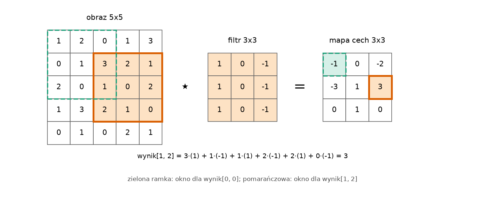
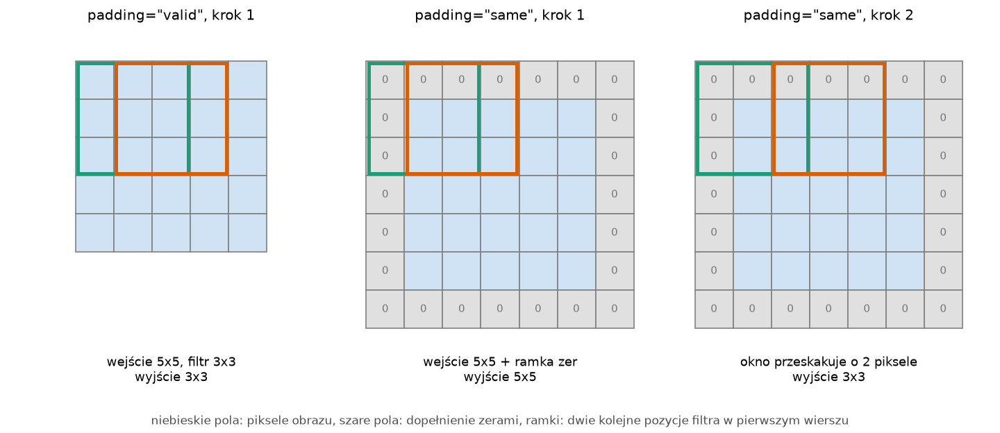
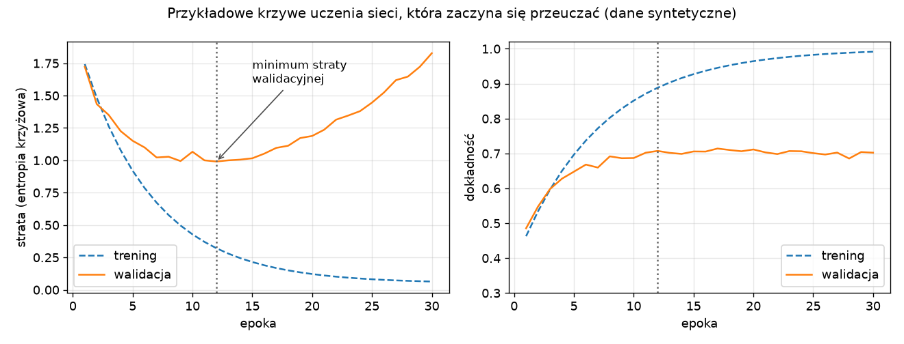
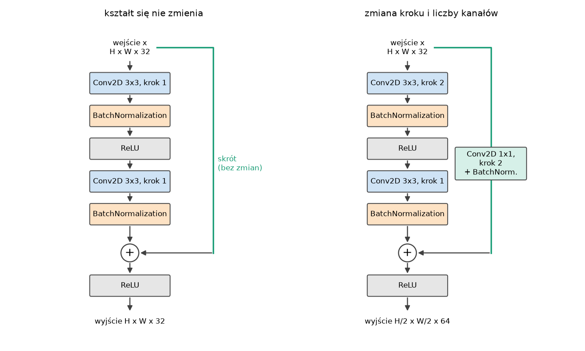

# Laboratorium 2: Sieci splotowe w klasyfikacji obrazów. Wprowadzenie

Ten tekst jest do przeczytania przed zajęciami. Zbiera pojęcia potrzebne we wszystkich zadaniach, także w zadaniach rozszerzonych o małym ResNecie. Nie ma w nim odpowiedzi na pytania z instrukcji, ma za to pomóc Wam wyjaśnić własne liczby i wykresy, gdy już je zobaczycie.

## Obraz jako tensor

Kolorowy obraz to w Keras tablica o kształcie (wysokość, szerokość, kanały), w skrócie HxWxC. Zdjęcie z CIFAR-10 ma kształt (32, 32, 3), czyli trzy kanały barw R, G, B. Obrazy trafiają do sieci w paczkach (batch), więc warstwa dostaje tensor (N, H, W, C), domyślny w Keras układ `channels_last`. Nawet jeden obraz podaje się z osią paczki, dlatego w zadaniu 2 obraz w skali szarości (32, 32) zamienia się na (1, 32, 32, 1).

`Flatten` układa wszystkie liczby obrazu w jeden wektor, dla CIFAR-10 o długości 32 * 32 * 3 = 3072. Następna warstwa `Dense` ma osobną wagę dla każdej pary (wejście, neuron) i jeden bias na neuron:

```
parametry Dense = (liczba wejść + 1) * liczba neuronów
```

Licząc parametry MLP z zadania 1, zastanówcie się też, czy `Dense` dostaje jakąkolwiek informację o tym, które wejścia leżały na obrazie obok siebie.

## Splot i korelacja wzajemna

Filtr (filter, w dokumentacji Keras kernel) to mała tablica wag, na przykład 3x3. Warstwa splotowa przykłada go po kolei do każdego okna obrazu tej samej wielkości, mnoży leżące na sobie liczby i sumuje iloczyny. Wynik trafia w odpowiednie miejsce mapy cech (feature map):

```
wynik[i, j] = suma po m, n z  obraz[i + m, j + n] * filtr[m, n]
```



Filtr na rysunku ma dodatnie wagi w lewej kolumnie i ujemne w prawej, więc daje duży wynik tam, gdzie lewa część okna jest jaśniejsza od prawej, i zero na jednolitym tle. Podobnie działają filtry Sobela z zadania 2, a filtr rozmywający ma wszystkie wagi równe 1/9 i liczy średnią z okna.

W matematyce takie działanie nazywa się korelacją wzajemną (cross-correlation). Splot (convolution) w ścisłym sensie, liczony na przykład przez `scipy.signal.convolve2d`, przebiega indeksy filtra w odwrotnej kolejności, co oznacza obrót filtra o 180 stopni:

```
splot[i, j] = suma po m, n z  obraz[i + m, j + n] * filtr[kh-1-m, kw-1-n]
```

`Conv2D` w Keras liczy korelację wzajemną, choć nazywa się warstwą splotową. Do wyniku każdego filtra dodaje bias i stosuje aktywację, jeśli ją podano. W zadaniu 2 bias jest wyłączony (`use_bias=False`), żeby wynik dało się porównać z numpy.

## Krok, dopełnianie i rozmiar mapy cech

Krok (stride, argument `strides`) to liczba pikseli, o którą filtr przesuwa się między kolejnymi pozycjami. Przy `padding="valid"`, domyślnym w `Conv2D`, filtr odwiedza tylko pozycje, w których mieści się w obrazie w całości, więc mapa cech jest mniejsza od wejścia. Przy `padding="same"` obraz otacza się zerami (dopełnianie) tak, żeby przy kroku 1 wyjście miało rozmiar wejścia.



Dla wymiaru o długości H, filtra albo okna poolingu o rozmiarze k i kroku s (floor to zaokrąglenie w dół):

```
valid:  H_wyj = floor((H - k) / s) + 1
same:   H_wyj = floor((H - 1) / s) + 1
```

`MaxPooling2D(2)` ma domyślnie krok równy rozmiarowi okna i `padding="valid"`. Krok 2 w samej warstwie splotowej, jak w pierwszym splocie bloku rezydualnego, zmniejsza mapę bez osobnego poolingu.

## Wagi i liczba parametrów Conv2D

Filtr warstwy splotowej obejmuje zawsze wszystkie kanały wejścia. Przy C_we kanałach jeden filtr 3x3 to w rzeczywistości blok 3x3xC_we wag, a jego odpowiedź w danym miejscu to suma iloczynów po całym bloku plus bias. Każdy filtr daje jeden kanał wyjścia, więc `Conv2D(filters=C_wy, kernel_size=k)` zwraca C_wy map cech:

```
kernel: (k, k, C_we, C_wy)        bias: (C_wy,)
parametry Conv2D = (k * k * C_we + 1) * C_wy
```

Przykładowo `Conv2D(8, 5)` na obrazie w skali szarości ma (5 * 5 * 1 + 1) * 8 = 208 parametrów. Ten sam filtr działa w każdym miejscu obrazu i to współdzielenie wag (weight sharing) najbardziej odróżnia warstwę splotową od gęstej. Porównajcie, jakie wielkości występują we wzorze dla `Conv2D`, a jakie we wzorze dla `Dense`.

Wagi warstwy powstają dopiero po wywołaniu jej na danych albo po `build(kształt)`. `get_weights()` zwraca listę tablic (przy `use_bias=False` tylko kernel), a `set_weights` przyjmuje listę o tych samych kształtach. W `layer.output.shape` pierwsza oś `None` oznacza dowolny rozmiar paczki.

## Pooling i ekwiwariancja

`MaxPooling2D(2)` dzieli każdą mapę cech na rozłączne okna 2x2 i z każdego zostawia największą wartość. Działa na każdym kanale osobno, nie ma wag i nie zmienia liczby kanałów.

Przekształcenie f jest ekwiwariantne względem przesunięcia, jeśli przesunięcie wejścia daje tak samo przesunięte wyjście: f(przesuń(x)) = przesuń(f(x)). Niezmienniczość (invariance) jest mocniejsza: f(przesuń(x)) = f(x). Myśląc o poolingu, sprawdźcie, co stanie się z maksimum z okna 2x2, gdy najsilniejsza odpowiedź przesunie się o piksel, ale nie opuści okna.

## Pole recepcyjne i hierarchia cech

Element mapy cech zależy tylko od fragmentu obrazu, który nazywa się jego polem recepcyjnym (receptive field). Po jednym splocie 3x3 ma ono 3x3 piksele, po dwóch już 5x5. Pooling i krok większy od 1 przyspieszają ten wzrost, bo sąsiednie elementy mapy leżą potem dalej od siebie na obrazie:

```
r_nowe = r + (k - 1) * j        r: pole recepcyjne, k: rozmiar filtra lub okna
j_nowe = j * s                  j: odstęp elementów mapy w pikselach, s: krok
na wejściu r = 1, j = 1
```

Dla ciągu splot 3x3, splot 3x3, pooling 2x2 wychodzi 3, 5 i 6 pikseli, a następny splot 3x3 daje od razu 10. Stąd hierarchia cech: pierwsza warstwa widzi kilka pikseli i może reagować tylko na krawędzie i plamy koloru, dalsze składają z nich tekstury i kształty, a najgłębsze mogą reagować na fragmenty obiektów.

W zadaniu 6 filtry `conv1a` o kształcie (3, 3, 3, 32) ogląda się jako 32 maleńkie obrazy RGB. Mapy cech wyciąga model pomocniczy `keras.Model(model.inputs, [model.get_layer(n).output for n in nazwy])`, który ma te same wagi co oryginał, ale zwraca wyjścia wskazanych warstw. ReLU zeruje wartości ujemne, więc kanał może mieć pustą mapę dla jednego obrazu tylko dlatego, że na tym obrazie nie ma wzoru, na który reaguje. Kanał pusty dla wszystkich 500 obrazów to inna sytuacja.

## Przeuczenie i krzywe uczenia

Przeuczenie (overfitting) zachodzi, gdy model coraz lepiej dopasowuje się do zbioru treningowego, a na danych, których nie widział, przestaje się poprawiać albo się pogarsza. Niedouczenie (underfitting) to stan odwrotny: model jest za słaby albo trenowany za krótko i myli się na obu zbiorach. Oba widać na krzywych uczenia (na rysunku dane syntetyczne, trening linią przerywaną jak w `rysuj_krzywe`).



Dokładność sprawdza tylko, czy klasa z największym prawdopodobieństwem jest poprawna. Entropia krzyżowa dla jednego przykładu zależy od prawdopodobieństwa p, jakie model dał poprawnej klasie:

```
strata = -log(p)        p = 0,9: 0,11    p = 0,5: 0,69    p = 0,01: 4,6
```

Ten wzór przyda się, gdy krzywe straty i dokładności walidacyjnej zaczną się zachowywać różnie. Epokę z najmniejszą stratą walidacyjną daje `np.argmin(historia.history["val_loss"]) + 1`, bo indeksy liczy się od 0.

## Wybór modelu na walidacji

Na zbiorze treningowym sieć uczy się wag, na walidacyjnym porównuje się warianty, a testowy służy do jednej oceny modelu, który już wybrano. Każdy wariant buduje się po `keras.utils.set_random_seed(RANDOM_STATE)` i trenuje przez tę samą liczbę epok. Dokładność walidacyjna waha się z epoki na epokę bez żadnej zmiany w modelu, więc różnica mniejsza od tych wahań niewiele mówi o kolejności. Jeśli krzywa w ostatnich epokach jeszcze rośnie, wynik po ostatniej epoce mówi o budżecie treningu nie mniej niż o samym modelu.

## Augmentacja i tryb treningowy warstw

Augmentacja danych (data augmentation) w każdej epoce podaje sieci nowe, losowo zmienione wersje obrazów treningowych z tą samą etykietą. W Keras 3 robią to warstwy umieszczone na początku modelu. `RandomFlip("horizontal")` losowo odbija obraz w poziomie. `RandomTranslation(0.1, 0.1)` przesuwa go w pionie i poziomie najwyżej o 10% rozmiaru, a `RandomRotation(0.05)` obraca najwyżej o 0,05 pełnego obrotu (18 stopni) w każdą stronę. Puste miejsca wypełniane są według parametru `fill_mode`, w Keras 3 domyślnie `"reflect"`, czyli lustrzanym odbiciem brzegu obrazu. Przekształcenie musi zachowywać etykietę, więc przy każdym trzeba zapytać, czy obiekt danej klasy po nim nadal wygląda jak obiekt tej klasy.

Część warstw działa inaczej w treningu i w predykcji. `fit` wywołuje model z `training=True`, a `evaluate` i `predict` z `training=False`. Warstwa augmentacji wywołana bez `training=True` zwraca obraz bez zmian, więc przy podglądzie ośmiu wersji obrazu trzeba ten argument podać. Tak samo zachowują się `Dropout` i `BatchNormalization`. Strata i dokładność treningowa z `fit` to średnie ze wszystkich paczek epoki, liczone w trybie treningowym, a wartości walidacyjne powstają na końcu epoki w trybie predykcji. Każdy model z augmentacją dostaje nowy obiekt `zbuduj_augmentacje()`, bo jedna warstwa użyta w dwóch modelach byłaby dla nich wspólna.

## Dropout

`Dropout(rate)` w każdym kroku treningu zeruje losowo wybrany ułamek `rate` wartości, a pozostałe mnoży przez 1 / (1 - rate), żeby ich suma średnio się nie zmieniła. Każda paczka trenuje więc trochę inną podsieć i żaden neuron nie może polegać na konkretnym sąsiedzie. W predykcji warstwa nic nie robi. Nie ma wag, więc nie zmienia liczby parametrów.

## Regularyzacja L2 a raportowana strata

L2 dodaje do straty karę za duże wagi. W Keras ustawia się ją dla każdej warstwy osobno przez `kernel_regularizer=keras.regularizers.L2(l2)`, a kara obejmuje wtedy kernel bez biasu:

```
kara warstwy = l2 * suma(w^2)
strata       = entropia krzyżowa + suma kar wszystkich warstw
```

Gradient kary ciągnie każdą wagę w stronę zera proporcjonalnie do jej wartości, więc sieć woli wiele małych wag od kilku dużych. Keras raportuje stratę razem z karą: wchodzi ona do `loss` i do straty liczonej na walidacji, czyli także do `val_loss`. Dokładność od kary nie zależy.

## Blok rezydualny

Bardzo głębokie sieci zbudowane z samych splotów trenują się gorzej niż płytsze, nawet na zbiorze treningowym. ResNet (He i in., 2016) wprowadza połączenie rezydualne (skip connection): wejście bloku x omija dwa sploty i jest dodawane do ich wyniku F(x):

```
F(x) = BN(Conv3x3( ReLU(BN(Conv3x3(x))) ))
y    = ReLU( F(x) + x )
```

Jeśli dla danego bloku najlepiej byłoby nic nie zmieniać, wystarczy, że nauczy się F(x) bliskiego zeru. Gradient dociera też do wcześniejszych warstw przez samo dodawanie.



`Add` dodaje tensory element po elemencie i wymaga identycznych kształtów. Gdy pierwszy splot ma krok 2 albo liczba filtrów różni się od liczby kanałów wejścia, skrót dopasowuje się splotem 1x1 z tym samym krokiem i liczbą filtrów. Splot 1x1 nie patrzy na sąsiednie piksele, w każdym położeniu liczy tylko ważoną sumę kanałów i bez biasu ma C_we * C_wy wag. Sploty w bloku mają `use_bias=False`, bo zaraz po nich stoi `BatchNormalization` z własnym przesunięciem beta.

## Normalizacja wsadowa

`BatchNormalization` normalizuje każdy kanał osobno i skaluje wynik uczonymi parametrami gamma i beta. W treningu używa statystyk bieżącej paczki, w predykcji średnich kroczących (moving averages) zebranych podczas treningu:

```
trening:    y = gamma * (x - średnia_paczki) / sqrt(wariancja_paczki + eps) + beta
predykcja:  y = gamma * (x - moving_mean) / sqrt(moving_var + eps) + beta
            moving_mean = 0.99 * moving_mean + 0.01 * średnia_paczki   (tak samo moving_var)
```

Współczynnik 0,99 to domyślny `momentum`. Stabilna skala wejść kolejnych warstw ułatwia trening głębokich sieci. Ewaluacja modelu z BN korzysta ze średnich kroczących, co ma znaczenie przy czytaniu krzywych walidacyjnych. Warstwa BN ma 4 * C parametrów, z czego uczone są tylko gamma i beta, ale `count_params()` liczy wszystkie.

## GlobalAveragePooling2D a Flatten

Na końcu części splotowej tensor H x W x C trzeba zamienić w wektor. `Flatten` zachowuje wszystkie H * W * C liczb. `GlobalAveragePooling2D` (Lin i in., 2014) liczy dla każdego kanału średnią po wszystkich położeniach i zwraca wektor długości C. Dla przykładowej mapy 4 x 4 x 256 i 10 klas:

```
Flatten:  wektor 4096,  Dense(10) ma (4096 + 1) * 10 = 40 970 parametrów
GAP:      wektor 256,   Dense(10) ma (256 + 1) * 10  =  2 570 parametrów
```

Pytając, co GAP traci, porównajcie, które liczby z mapy trafiają do wektora w obu wariantach.

## Literatura i dokumentacja

- F. Chollet, Deep Learning with Python, 2. wydanie, Manning 2021: rozdział 5 (przeuczenie, regularyzacja), rozdział 8 (wprowadzenie do sieci splotowych, augmentacja), rozdział 9 (połączenia rezydualne, normalizacja wsadowa, interpretacja tego, czego uczą się sieci splotowe).
- I. Goodfellow, Y. Bengio, A. Courville, Deep Learning, MIT Press 2016: rozdział 7 (regularyzacja), rozdział 9 (sieci splotowe, w tym splot i korelacja wzajemna): https://www.deeplearningbook.org
- J. Krohn, G. Beyleveld, A. Bassens, Uczenie głębokie i sztuczna inteligencja, Helion 2021.
- A. Krizhevsky, Learning Multiple Layers of Features from Tiny Images, raport techniczny, University of Toronto 2009 (CIFAR-10): https://www.cs.toronto.edu/~kriz/cifar.html
- N. Srivastava i in., Dropout: A Simple Way to Prevent Neural Networks from Overfitting, Journal of Machine Learning Research 15, 2014.
- S. Ioffe, C. Szegedy, Batch Normalization: Accelerating Deep Network Training by Reducing Internal Covariate Shift, ICML 2015.
- K. He, X. Zhang, S. Ren, J. Sun, Deep Residual Learning for Image Recognition, CVPR 2016.
- M. Lin, Q. Chen, S. Yan, Network In Network, ICLR 2014.
- Keras, CIFAR-10: https://keras.io/api/datasets/cifar10/
- Keras, Conv2D: https://keras.io/api/layers/convolution_layers/convolution2d/
- Keras, MaxPooling2D: https://keras.io/api/layers/pooling_layers/max_pooling2d/
- Keras, warstwy augmentacji obrazów: https://keras.io/api/layers/preprocessing_layers/image_augmentation/
- Keras, Dropout: https://keras.io/api/layers/regularization_layers/dropout/
- Keras, regularyzatory wag: https://keras.io/api/layers/regularizers/
- Keras, BatchNormalization: https://keras.io/api/layers/normalization_layers/batch_normalization/
- Keras, Add: https://keras.io/api/layers/merging_layers/add/
- Keras, GlobalAveragePooling2D: https://keras.io/api/layers/pooling_layers/global_average_pooling2d/
