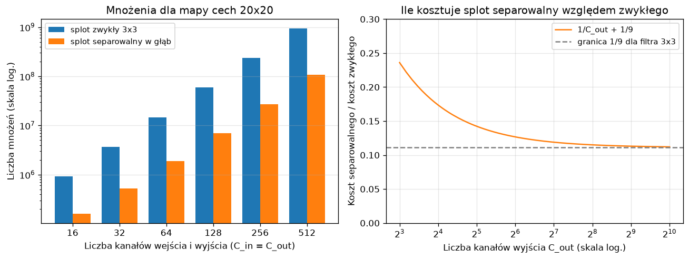
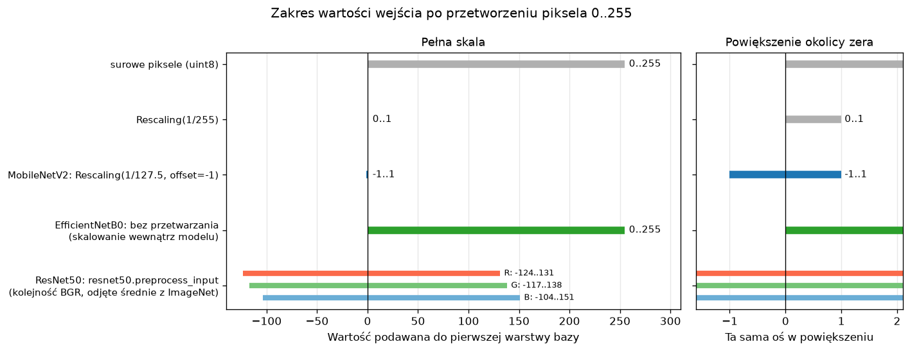
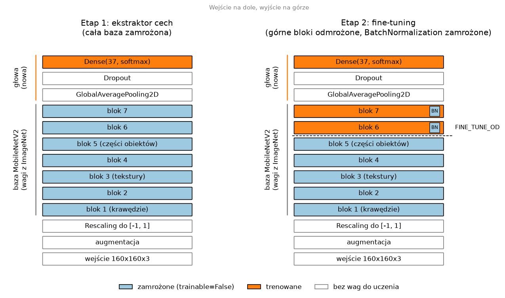
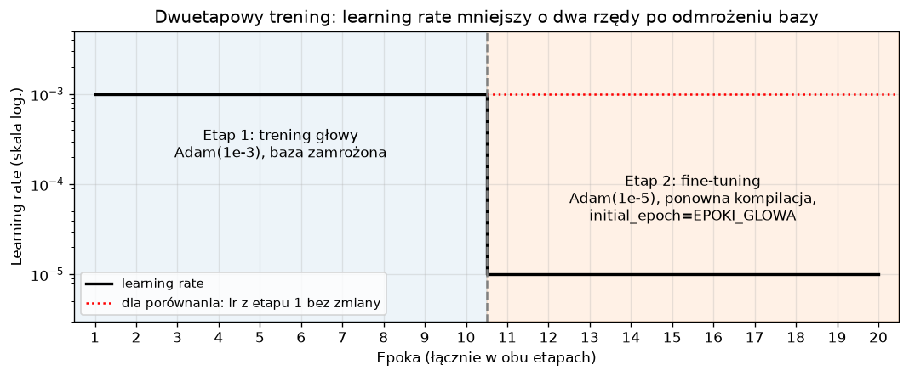

# Laboratorium 3: Transfer learning w klasyfikacji obrazów. Wprowadzenie

Ten tekst jest do przeczytania przed zajęciami. Zbiera pojęcia, z których korzystają wszystkie zadania, łącznie z rozszerzonymi, i wyjaśnia, co robią poszczególne wywołania Keras w notebooku.

## Mały zbiór i sieć uczona od zera

Sieć konwolucyjna inicjowana losowo musi sama nauczyć się wszystkiego: od krawędzi i plam koloru, przez tekstury sierści, po kształt ucha czy pyska. W laboratorium 2 było 50 tys. przykładów i 10 klas. W Oxford-IIIT Pet klas jest 37, a w części treningowej po wydzieleniu walidacji zostaje na każdą rasę mniej niż sto zdjęć. Różnice między klasami bywają przy tym drobne, a wewnątrz klasy duże: inna poza, oświetlenie, tło, szczeniak obok dorosłego psa.

Sieć z małą liczbą parametrów nie zbuduje cech rozróżniających podobne rasy, a sieć z dużą ich liczbą szybko zapamięta zbiór treningowy razem z przypadkowymi szczegółami tła. Augmentacja (odbicia, obroty, przybliżenia) trochę pomaga, bo każda epoka pokazuje nieco inne wersje tych samych zdjęć, ale nie tworzy nowych psów ani kotów. Losowe zgadywanie przy 37 klasach daje dokładność 1/37.

## ImageNet i cechy, które się przenoszą

ImageNet w wersji, na której trenowano modele z `keras.applications` (ILSVRC 2012), to około 1,2 mln zdjęć w 1000 klasach. Wśród nich jest ponad sto ras psów i kilka klas kotów, ale też samochody, narzędzia i jedzenie, więc sieć musiała zbudować bogaty zestaw cech pośrednich.

Yosinski i współautorzy (2014) pokazali, że pierwsze warstwy sieci konwolucyjnych uczonych na różnych zbiorach wyglądają bardzo podobnie: filtry reagują na krawędzie o różnych orientacjach i na plamy koloru. Wyżej cechy stają się coraz bardziej związane z konkretnym zadaniem. W tej samej pracy zmierzono też, że przenoszenie słabnie, gdy zadanie docelowe jest odległe od źródłowego.

## MobileNetV2 i splot separowalny w głąb

MobileNetV2 (Sandler i in., 2018) zaprojektowano z myślą o telefonach. Jej podstawą jest splot separowalny w głąb (depthwise separable convolution). Zwykły `Conv2D` z filtrem k x k obejmuje naraz przestrzeń i wszystkie kanały wejściowe. Splot separowalny rozbija to na dwa kroki: najpierw każdy kanał wejściowy jest filtrowany osobno własnym filtrem k x k (warstwa `DepthwiseConv2D`), a potem splot 1x1 miesza kanały. Dla mapy cech H x W i pominięcia biasów:

```
splot zwykły:       parametry = k*k*C_in*C_out          mnożenia = H*W*k*k*C_in*C_out
splot separowalny:  parametry = k*k*C_in + C_in*C_out   mnożenia = H*W*(k*k*C_in + C_in*C_out)

stosunek kosztów = 1/C_out + 1/(k*k)
```

Dla filtra 3x3 i kilkuset kanałów stosunek zbliża się do 1/9, czyli splot separowalny jest blisko dziewięć razy tańszy.



W MobileNetV2 te sploty są ułożone w bloki nazwane odwróconymi residuami (inverted residuals). Blok najpierw rozszerza liczbę kanałów splotem 1x1, potem stosuje splot w głąb 3x3, a na końcu zwęża kanały kolejnym splotem 1x1 bez nieliniowości (linear bottleneck). Przy równych wymiarach wejścia i wyjścia blok ma połączenie skrótowe jak w ResNet. W Keras cała baza to jeden obiekt `keras.Model` złożony ze 154 warstw, wśród których jest wiele warstw `BatchNormalization`.

## Baza, głowa i `include_top`

Model z `keras.applications` składa się z części konwolucyjnej (bazy) i klasyfikatora na 1000 klas ImageNet, który `include_top=False` odcina. Baza zwraca wtedy trójwymiarowy tensor map cech, a `input_shape=(160, 160, 3)` ustala rozmiar wejścia, dla którego Keras pobierze pasujące wagi.

Na bazę zakłada się nową głowę klasyfikacyjną (head). `GlobalAveragePooling2D` uśrednia każdą mapę cech po wysokości i szerokości, więc z tensora robi się wektor o długości równej liczbie kanałów. `Dropout` losowo zeruje część tego wektora w trakcie treningu, a `Dense` z softmaxem zamienia wektor na rozkład prawdopodobieństwa 37 ras. Głowa startuje z losowych wag.

## Przetwarzanie wejścia i zakres pikseli

Wagi bazy dopasowano do wejścia w konkretnym zakresie: MobileNetV2 widziała na ImageNet piksele przeskalowane do [-1, 1]. Każda baza w `keras.applications` ma swoją funkcję `preprocess_input`, która odtwarza właściwe przekształcenie. Dla MobileNetV2 jest to dokładnie to, co robi warstwa `Rescaling(1/127.5, offset=-1)`, czyli `x/127.5 - 1`. W notebooku używacie warstwy zamiast funkcji, bo warstwa staje się częścią modelu i zapisuje się razem z nim w pliku `.keras`.

Inne bazy oczekują czegoś innego. W Keras EfficientNetB0 ma skalowanie wbudowane w model jako warstwę `Rescaling`, więc dostaje surowe piksele 0..255, a `keras.applications.efficientnet.preprocess_input` niczego nie zmienia. Dla ResNet50 `keras.applications.resnet50.preprocess_input` zamienia kolejność kanałów z RGB na BGR i odejmuje od każdego kanału średnią z ImageNet, bez dzielenia przez 255.



Pomyłka w tym miejscu nie kończy się błędem wykonania: model się trenuje, tylko baza dostaje liczby z innego zakresu niż te, na których się uczyła.

## Ekstraktor cech i fine-tuning

Ustawienie `baza.trainable = False` zamraża bazę: jej wagi przechodzą do `non_trainable_weights` i optymalizator ich nie zmienia. Ustawienie działa rekurencyjnie na wszystkie warstwy w środku. Trenowana jest tylko głowa, a baza pełni rolę ekstraktora cech (feature extraction).

Fine-tuning to drugi etap. Odmraża się górną część bazy, czyli warstwy bliżej wyjścia, a dolne zostają zamrożone. W notebooku robi to pętla po `baza.layers` z progiem `FINE_TUNE_OD`.



Keras ustala listę trenowanych wag w momencie wywołania `compile`. Po zmianie `trainable` trzeba więc model skompilować ponownie, inaczej trening przebiega tak jak przed zmianą. Drugi etap kontynuuje numerację epok dzięki `initial_epoch`, a ten sam obiekt `ModelCheckpoint` z `save_best_only=True` pamięta najlepszy wynik z pierwszego etapu. Z `save_weights_only=True` plik musi mieć rozszerzenie `.weights.h5`.

## Learning rate przy fine-tuningu

Po odmrożeniu model ma dużo więcej swobodnych parametrów, a zbiór jest wciąż mały. Wagi bazy są już blisko dobrego rozwiązania i mają zostać lekko dopasowane, a nie przestawione. Długość kroku optymalizatora rośnie z learning rate, dlatego przewodnik Keras zaleca tu learning rate bardzo mały. W notebooku etap pierwszy używa `Adam(1e-3)`, a fine-tuning `Adam(1e-5)`.



Kolejność etapów też ma znaczenie. Przewodnik Keras zaznacza, że fine-tuning powinien zacząć się dopiero, gdy głowa z zamrożoną bazą jest już wytrenowana. Pomyślcie, jakie gradienty płyną do bazy, gdy nad nią siedzi losowo zainicjowana warstwa `Dense`.

## BatchNormalization, `training` i `trainable`

Warstwa `BatchNormalization` ma dwie wagi uczone gradientem (`gamma`, `beta`) i dwie nietrenowane (`moving_mean`, `moving_variance`). W trybie treningowym normalizuje aktywacje statystykami bieżącego batcha i przy okazji aktualizuje średnie kroczące, a w trybie wnioskowania (inference) używa średnich zapamiętanych, w MobileNetV2 policzonych na ImageNet.

Atrybut `trainable` mówi, czy optymalizator zmienia wagi warstwy. Argument `training` przy wywołaniu warstwy mówi, czy działa ona w trybie treningowym, czy wnioskowania. Zwykle te dwie rzeczy są od siebie niezależne. `Dropout` i warstwy augmentacji działają tylko w trybie treningowym, czyli w `fit`, a w `evaluate` i `predict` przepuszczają dane bez zmian. Wyjątkiem jest `BatchNormalization`: w Keras warstwa z `trainable=False` zawsze działa w trybie wnioskowania i nie zmienia średnich kroczących.

Przewodnik Keras zaleca `baza(x, training=False)`, żeby po odmrożeniu warstwy BatchNormalization dalej pracowały w trybie wnioskowania. Instrukcja opisuje pułapkę: w Keras 3.13.2, na którym przygotowano laboratorium, `fit` przekazuje do zagnieżdżonej bazy `training=True` i nadpisuje ten argument, więc średnie kroczące odmrożonej warstwy BatchNormalization się zmieniają. Zamrożonej bazy to nie dotyczy (reguła z poprzedniego akapitu), ale przy fine-tuningu warstwy `BatchNormalization` trzeba zostawić zamrożone jawnie (`isinstance(warstwa, layers.BatchNormalization)` w pętli), a `training=False` zostaje w kodzie jako zapis intencji. Porównanie `moving_mean` przed treningiem i po nim pokaże, czy to działa w waszej wersji Keras.

## Dane w pamięci i `tf.data`

W zadaniach 1 do 6 zdjęcia są tablicami NumPy `uint8` o kształcie (N, 160, 160, 3) trzymanymi w pamięci. `model.fit(X_train, y_train, batch_size=BATCH, ...)` sam dzieli je na batche i w każdej epoce je tasuje. Typ `uint8` zajmuje cztery razy mniej pamięci niż `float32`, a skalowanie odbywa się dopiero w modelu.

W zadaniu 7 zdjęcia leżą w plikach. `keras.utils.image_dataset_from_directory` przyjmuje nazwy podkatalogów jako nazwy klas (`class_names`, w porządku alfabetycznym), wczytuje obrazy, zmienia ich rozmiar do `image_size` i zwraca obiekt `tf.data.Dataset`, który od razu podaje batche par (obrazy `float32` w zakresie 0..255, etykiety całkowite). Domyślnie obraz jest skalowany do zadanego rozmiaru bez zachowania proporcji, tak jak w gotowej komórce z zadania 1. Batch ustala się przy wczytywaniu, a do `fit` trafia sam dataset. Z `validation_split=0.2` i `subset="both"` funkcja zwraca od razu oba podzbiory, rozdzielone losowo według `seed`.

## Ocena modelu

Zbiór walidacyjny służy do podejmowania decyzji: której epoki wagi zachować, który wariant modelu wybrać. Wybór dopasowany do tych konkretnych zdjęć sprawia, że najlepszy wynik walidacyjny jest trochę optymistyczny. Zbiór testowy mierzy się raz, dla jednego modelu wybranego wcześniej.

Sama dokładność nie mówi, gdzie model się myli. W macierzy pomyłek (`sklearn.metrics.confusion_matrix`) wiersze odpowiadają klasom prawdziwym, a kolumny przewidzianym, więc `cm[i, j]` to liczba zdjęć rasy i rozpoznanych jako j. Suma `cm[i, j] + cm[j, i]` daje pomyłki w obie strony dla pary ras.

Przy wielu klasach przydaje się też dokładność top-k (top-k accuracy): odsetek zdjęć, dla których prawdziwa klasa jest wśród k klas o najwyższym prawdopodobieństwie. Notebook jej nie wymaga, ale można ją dodać do `metrics` w `compile` jako `keras.metrics.SparseTopKCategoricalAccuracy(k=5)` albo policzyć z wyniku `predict`. Duża różnica między top-1 a top-5 sugeruje, że model zwykle wie, w której grupie podobnych ras szukać, a myli się w jej obrębie.

## Zapis modelu w formacie `.keras`

`model.save("lab03_pets.keras")` zapisuje w jednym pliku (archiwum zip) architekturę, wagi i konfigurację kompilacji ze stanem optymalizatora. Zapisują się też warstwy augmentacji i `Rescaling`, bo są częścią modelu. `keras.models.load_model` odtwarza model bez kodu, który go zbudował. Z warstwą `Lambda` opakowującą funkcję Pythona byłoby trudniej: przy wczytywaniu trzeba by podać tę funkcję w `custom_objects` albo wyłączyć `safe_mode`, który domyślnie blokuje deserializację lambd. Warstwa `Rescaling` tego nie wymaga. Plik w Colabie znika razem z sesją, a będzie potrzebny w laboratorium 4.

## Porównanie baz

W zadaniu rozszerzonym 6 trzy bazy dostają tę samą głowę i ten sam budżet: tyle samo epok, ten sam batch, te same dane i ten sam seed ustawiony przez `keras.utils.set_random_seed` przed każdym modelem. Poza dokładnością liczą się rozmiar bazy (`count_params()`) i czas epoki, bo telefon i serwer z GPU mają inne ograniczenia. Pierwsza epoka zawiera kompilację grafu obliczeń, więc średni czas podajcie też bez niej.

## Mały własny zbiór i przeciek

Przy 30 zdjęciach na klasę i podziale 80/20 zbiór walidacyjny ma kilkanaście zdjęć. Jedno zdjęcie zmienia wtedy dokładność o kilka punktów procentowych.

Groźniejszy jest przeciek informacji (data leakage) między treningiem a walidacją. Zdjęcia robione seriami w jednym miejscu są do siebie prawie identyczne, a `image_dataset_from_directory` dzieli pliki losowo, więc bliźniacze ujęcia trafiają po obu stronach podziału. Podobnie działa wspólne tło: jeśli każdą kategorię fotografowaliście na innym stole albo przy innym świetle, sieć może nauczyć się stołu. Uczciwszy sprawdzian dają zdjęcia zrobione później i gdzie indziej. Orientacji zapisanej w metadanych EXIF zdjęć z telefonu dekodowanie JPEG w TensorFlow nie uwzględnia, więc część zdjęć może wczytać się obrócona; obejrzyjcie siatkę przykładów.

## Literatura i dokumentacja

- F. Chollet, Deep Learning with Python, 2. wydanie, Manning 2021: rozdział 8 (podrozdział o wykorzystaniu sieci wytrenowanej wcześniej: ekstrakcja cech i fine-tuning) i rozdział 9 (interpretacja sieci konwolucyjnych, Grad-CAM).
- I. Goodfellow, Y. Bengio, A. Courville, Deep Learning, MIT Press 2016: rozdział 9 (sieci konwolucyjne) i podrozdział 15.2 (transfer learning i adaptacja dziedziny), https://www.deeplearningbook.org
- Keras, przewodnik Transfer learning & fine-tuning: https://keras.io/guides/transfer_learning/
- Keras Applications: https://keras.io/api/applications/, w tym https://keras.io/api/applications/mobilenet/, https://keras.io/api/applications/efficientnet/ i https://keras.io/api/applications/resnet/
- Keras, wczytywanie obrazów z katalogów (`image_dataset_from_directory`): https://keras.io/api/data_loading/image/
- Keras, `ModelCheckpoint`: https://keras.io/api/callbacks/model_checkpoint/
- Keras, zapis i wczytywanie modeli: https://keras.io/guides/serialization_and_saving/
- Keras, metryki dokładności (w tym `SparseTopKCategoricalAccuracy`): https://keras.io/api/metrics/accuracy_metrics/
- TensorFlow, przewodnik po `tf.data`: https://www.tensorflow.org/guide/data
- O. M. Parkhi, A. Vedaldi, A. Zisserman, C. V. Jawahar, Cats and Dogs, CVPR 2012 (zbiór Oxford-IIIT Pet): https://www.robots.ox.ac.uk/~vgg/data/pets/
- M. Sandler, A. Howard, M. Zhu, A. Zhmoginov, L.-C. Chen, MobileNetV2: Inverted Residuals and Linear Bottlenecks, CVPR 2018: https://arxiv.org/abs/1801.04381
- M. Tan, Q. V. Le, EfficientNet: Rethinking Model Scaling for Convolutional Neural Networks, ICML 2019.
- K. He, X. Zhang, S. Ren, J. Sun, Deep Residual Learning for Image Recognition, CVPR 2016.
- J. Yosinski, J. Clune, Y. Bengio, H. Lipson, How transferable are features in deep neural networks?, NeurIPS 2014: https://arxiv.org/abs/1411.1792
