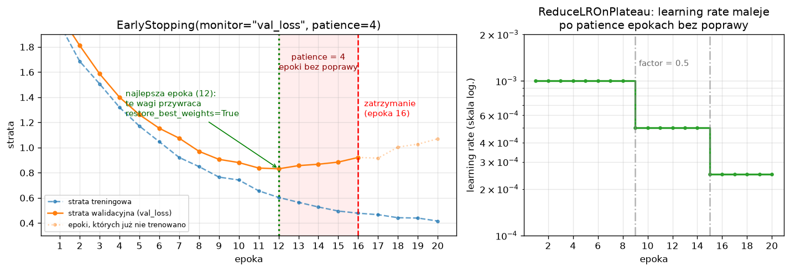
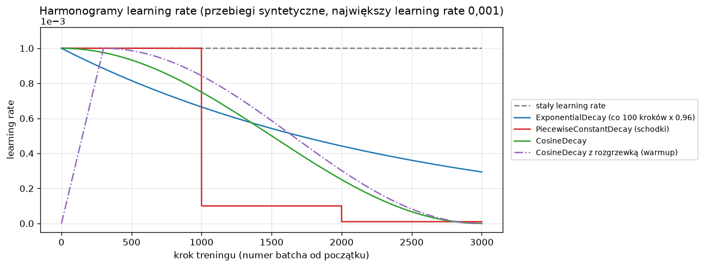
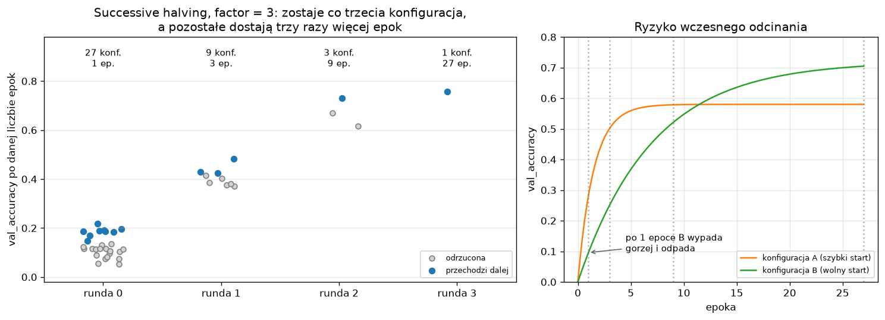
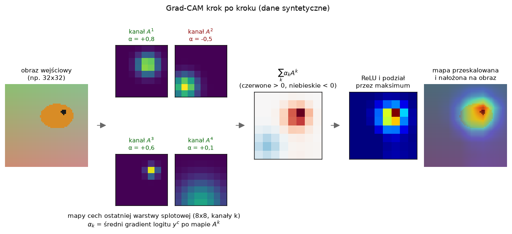

# Laboratorium 4: Tuning i ewaluacja sieci neuronowych. Wprowadzenie

Ten tekst jest do przeczytania przed zajęciami. Zbiera pojęcia potrzebne we wszystkich zadaniach, także rozszerzonych, i objaśnia, co robią klasy Keras, KerasTunera i scikit-learn użyte w notebooku. Gotowych odpowiedzi na pytania z instrukcji tu nie ma.

## Parametry, hiperparametry i trzy zbiory

Parametry modelu to wagi i biasy, które sieć ustala sama podczas `fit`. Hiperparametry (liczba filtrów, dropout, optymalizator, learning rate) wybieracie przed treningiem i żaden gradient ich nie poprawi, więc dobiera się je, porównując warianty na zbiorze walidacyjnym, tutaj `N_VAL` ostatnich obrazów części treningowej CIFAR-10. Każda decyzja podjęta na podstawie wyniku (wybór epoki, konfiguracji, modelu) sprawia, że wynik na zbiorze użytym do tej decyzji przestaje być niezależną oceną. Dlatego wszystkie wybory opierają się na walidacji, a test liczy się na końcu, jeden raz, dla modelu już wybranego.

## Callbacki i moment ich wywołania

Callback to obiekt przekazywany do `fit` w liście `callbacks=[...]`. Keras wywołuje jego metody w ustalonych chwilach pętli treningowej: `on_train_begin` przed pierwszą epoką, `on_epoch_begin` na początku każdej epoki, `on_train_batch_begin` i `on_train_batch_end` wokół każdego kroku, `on_epoch_end` po zakończeniu epoki i `on_train_end` na samym końcu. W `on_epoch_end` słownik `logs` zawiera już wyniki walidacji (`val_loss`, `val_accuracy`), dlatego wszystkie trzy callbacki z zadania 1 podejmują decyzje właśnie wtedy. Własnym callbackiem jest `LicznikEpok` z szablonu.

Callback ma stan (najlepsza dotąd wartość, liczba epok bez poprawy, czasem kopia wag), dlatego dla każdego treningu tworzy się nowe obiekty. KerasTuner kopiuje callbacki przed każdą próbą, co tłumaczy, dlaczego licznik w `LicznikEpok` jest atrybutem klasy.

## EarlyStopping i ModelCheckpoint

`EarlyStopping` obserwuje wskazaną wielkość (`monitor="val_loss"`) i zatrzymuje trening, gdy przez `patience` kolejnych epok nie nastąpiła poprawa względem najlepszej dotąd wartości. Kierunek poprawy Keras odgaduje z nazwy monitorowanej wielkości (`mode="auto"`). Numer ostatniej epoki zapisuje atrybut `stopped_epoch`, liczony od zera, a gdy zatrzymania nie było, zostaje w nim 0.

Bez dodatkowych opcji model kończy z wagami z ostatniej epoki. `restore_best_weights=True` zapamiętuje wagi z najlepszej epoki i wpisuje je do modelu na końcu treningu. Wczesne zatrzymanie ogranicza czas, przez jaki sieć dopasowuje się do szczegółów zbioru treningowego, dlatego zalicza się je do metod regularyzacji (Goodfellow i in., rozdz. 7).



`ModelCheckpoint` zapisuje model do pliku po epoce, a z `save_best_only=True` tylko wtedy, gdy monitorowana wartość jest najlepsza z dotychczasowych. Plik `.keras` zawiera cały model (architekturę, wagi, stan kompilacji) i wczytuje się go przez `keras.models.load_model`. Przy `save_weights_only=True` Keras 3 wymaga rozszerzenia `.weights.h5`.

## Learning rate w trakcie treningu

`ReduceLROnPlateau` działa podobnie jak `EarlyStopping`, ale zamiast przerywać trening mnoży learning rate przez `factor`, gdy przez `patience` epok monitorowana wartość się nie poprawia. Dolną granicę wyznacza `min_lr`. Decyzja zapada w `on_epoch_end`, więc nowa wartość obowiązuje od następnej epoki, a historia zapisuje learning rate każdej epoki pod kluczem `learning_rate`.

Zmianę learning rate można też zaplanować z góry, niezależnie od walidacji. Obiekt z `keras.optimizers.schedules` (np. `ExponentialDecay`, `PiecewiseConstantDecay`, `CosineDecay`) przekazuje się zamiast liczby jako `learning_rate` optymalizatora i wtedy wartość zmienia się w każdym kroku:

```
ExponentialDecay:  lr(krok) = lr0 * decay_rate ^ (krok / decay_steps)
CosineDecay:       lr(krok) = lr0 * 0.5 * (1 + cos(pi * krok / decay_steps))
```

`CosineDecay` ma też opcjonalną rozgrzewkę (warmup, argumenty `warmup_steps` i `warmup_target`), w której learning rate najpierw rośnie liniowo. Callback `LearningRateScheduler` robi to samo co epokę, wywołując funkcję `schedule(epoch, lr)`.



## Optymalizatory

Zwykły SGD (stochastic gradient descent) robi krok przeciwny do gradientu z batcha. Momentum dodaje pamięć poprzednich kroków (wzory z dokumentacji `keras.optimizers.SGD`):

```
bez momentum:   w = w - lr * g
z momentum:     v = momentum * v - lr * g
                w = w + v
```

Przy `momentum=0.9` prędkość `v` jest w przybliżeniu wykładniczo ważoną sumą ostatnich gradientów. Składowe, które zmieniają znak z kroku na krok, częściowo się znoszą, a te o stałym kierunku się sumują.

Metody adaptacyjne skalują krok osobno dla każdej wagi. RMSprop trzyma średnią kroczącą kwadratów gradientu i dzieli przez jej pierwiastek, więc wagi z dużymi gradientami dostają mniejsze kroki. Adam (Kingma i Ba, 2015) łączy oba pomysły: średnią kroczącą gradientu (moment pierwszego rzędu) i kwadratów gradientu (moment drugiego rzędu), z poprawką na to, że obie średnie startują od zera:

```
m = beta_1 * m + (1 - beta_1) * g             domyślnie beta_1 = 0.9
s = beta_2 * s + (1 - beta_2) * g^2           domyślnie beta_2 = 0.999
m_hat = m / (1 - beta_1^t),  s_hat = s / (1 - beta_2^t)
w = w - lr * m_hat / (sqrt(s_hat) + epsilon)
```

Za duży learning rate psuje też Adama: kroki przeskakują dolinę straty, strata rośnie lub staje się `nan`, a sieć może utknąć w stanie, w którym przewiduje zawsze to samo.

Spadek wag (weight decay) to w każdym kroku pomniejszanie wag o niewielki ułamek ich wartości. Dla zwykłego SGD daje to ten sam efekt co kara L2 dodana do straty, ale w Adamie gradient kary przechodzi przez dzielenie przez `sqrt(s_hat)` i działa na różne wagi z różną siłą. AdamW (Loshchilov i Hutter, 2019) oddziela więc spadek wag od kroku adaptacyjnego i odejmuje go bezpośrednio od wag. W Keras 3 argument `weight_decay` mają wszystkie optymalizatory, a `keras.optimizers.AdamW` ustawia go domyślnie na 0,004.

## Przeszukiwanie hiperparametrów

Przestrzeń hiperparametrów to zbiór wszystkich dopuszczalnych konfiguracji. W KerasTunerze opisuje ją funkcja budująca model, która pyta obiekt `hp` o wartości, np. `hp.Choice("dropout", [0.0, 0.25, 0.5])`. Dla przedziałów służą `hp.Int` i `hp.Float`.

Przeszukiwanie siatki (grid search, `kt.GridSearch`) sprawdza wszystkie kombinacje po kolei. Przeszukiwanie losowe (`kt.RandomSearch`) losuje `max_trials` konfiguracji, więc budżet jest ustalony z góry niezależnie od rozmiaru przestrzeni. Bergstra i Bengio (2012) zwrócili uwagę, że siatka powtarza te same wartości każdego hiperparametru wiele razy, a przy losowaniu każda próba może wnieść nową wartość na każdej osi. Zastanówcie się, co z tego wynika, gdy tylko jeden z hiperparametrów naprawdę wpływa na wynik.

Próba (trial) to wytrenowanie modelu z jedną konfiguracją. Dla `objective="val_accuracy"` jej wynikiem jest najlepsza `val_accuracy` spośród epok, a najlepsze konfiguracje zwraca `get_best_hyperparameters(n)`. Budżet przeszukiwania liczy się w epokach zsumowanych po wszystkich próbach.

Wybór najlepszej spośród wielu prób na tym samym zbiorze walidacyjnym niesie ryzyko dopasowania do walidacji. Każdy wynik zawiera trochę przypadku, a maksimum z wielu wyników częściej trafia na próbę, której przypadek sprzyjał. Wynik zwycięzcy jest więc zwykle optymistyczny, tym bardziej, im więcej było prób.

Najlepszą konfigurację z tunera trenuje się potem ponownie od zera, z callbackami, i dopiero ten model porównuje z innymi kandydatami.

## Hyperband i successive halving

Successive halving zaczyna od wielu konfiguracji trenowanych bardzo krótko, ocenia je, zostawia najlepszą część (przy `factor=3` mniej więcej co trzecią) i daje jej `factor` razy więcej epok. Powtarza to, aż zostanie jedna lub kilka konfiguracji trenowanych do `max_epochs`. Ceną taniego odrzucania jest założenie, że ranking po krótkim treningu przewiduje ranking po długim. Konfiguracja, która startuje wolno (np. z mniejszym learning rate albo silnym dropoutem), może odpaść, zanim pokaże, na co ją stać.



Hyperband (Li i in., 2018) uruchamia kilka takich serii (brackets) o różnych proporcjach: w jednej jest wiele konfiguracji i ostre odcinanie, w innej mało konfiguracji trenowanych od razu dłużej. W `kt.Hyperband` podajecie `max_epochs`, `factor` i `hyperband_iterations` zamiast `max_trials` i `epochs`. Awans do kolejnej rundy to osobna próba, która wczytuje wagi z poprzedniej i trenuje dalej, więc w tabeli prób ta sama konfiguracja występuje w kilku wierszach. Kolumny `tuner/epochs`, `tuner/initial_epoch`, `tuner/bracket` i `tuner/round` mówią, do której epoki trenowano próbę, od której zaczęto, w której serii i w której rundzie.

## Ewaluacja na zbiorze testowym

Macierz pomyłek (`confusion_matrix`) ma w wierszu `i` i kolumnie `j` liczbę obrazów klasy prawdziwej `i`, które model przypisał do klasy `j`. Przekątna to trafienia, a największe elementy poza nią pokazują pary klas mylone najczęściej. Z niej liczy się miary dla każdej klasy osobno:

```
precision = TP / (TP + FP)     jaka część obrazów oznaczonych jako ta klasa naprawdę do niej należy
recall    = TP / (TP + FN)     jaka część obrazów tej klasy została rozpoznana
F1        = 2 * precision * recall / (precision + recall)
```

Tutaj TP to obrazy klasy poprawnie do niej przypisane, FP obrazy innych klas przypisane do niej, a FN obrazy tej klasy przypisane gdzie indziej. Dokładność (accuracy) to natomiast odsetek wszystkich trafień, bez rozróżnienia klas. Średnia makro (`average="macro"`) to zwykła średnia z miar wszystkich klas, każda klasa liczy się tak samo. Średnia ważona (`average="weighted"`) waży klasy liczbą ich przykładów (support), więc duże klasy ważą w niej więcej. `classification_report` wypisuje precision, recall, F1 i support dla każdej klasy oraz wiersze `accuracy`, `macro avg` i `weighted avg`.

Najpewniejsze błędy to pomyłki posortowane według prawdopodobieństwa, jakie model przypisał błędnej klasie. Pokazują, czy model myli się na obrazach niejednoznacznych, czy np. kieruje się tłem, a czasem odsłaniają błędy w etykietach.

## Zmienność między ziarnami

Ta sama konfiguracja trenowana z innym ziarnem (`keras.utils.set_random_seed`) startuje z innych wag, widzi batche w innej kolejności i inaczej losuje dropout, więc daje trochę inny wynik. Rozrzut ocenia się odchyleniem standardowym z próby:

```
s = sqrt( suma (x_i - średnia)^2 / (n - 1) )      w numpy: np.std(x, ddof=1)
```

Przy trzech powtórzeniach `s` jest mało dokładne, ale daje rząd wielkości szumu. Różnicę między dwiema konfiguracjami porównuje się z tym szumem: różnica dużo mniejsza od `s` nie pozwala wskazać lepszej. KerasTuner pozwala trenować każdą konfigurację kilka razy (`executions_per_trial`) i uśredniać wynik, co zmniejsza wariancję kosztem proporcjonalnie większego budżetu.

## Grad-CAM

Grad-CAM (Selvaraju i in., 2017) odpowiada na pytanie, które miejsca obrazu najbardziej podniosły wynik wybranej klasy `c`. Korzysta z map cech `A^k` ostatniej warstwy splotowej (kanały `k`, rozmiar `Z = H x W` pól) i z logitu `y^c`, czyli wyniku klasy przed softmaxem:

```
alpha_k = (1/Z) * suma po (i, j) z  d y^c / d A^k_ij      waga kanału: średni gradient
L^c     = ReLU( suma po k z  alpha_k * A^k )             mapa H x W
```

Gradient mówi, jak wzrósłby logit przy niewielkim wzroście aktywacji w danym polu, a średnia po polach daje wagę kanału. Suma ważona ma ujemne pola tam, gdzie aktywacje przemawiają przeciw klasie, i ReLU je obcina. Mapę dzieli się przez jej maksimum, skaluje dwuliniowo do rozmiaru obrazu i nakłada półprzezroczyście na zdjęcie.



W notebooku gradient liczy `tf.GradientTape`, więc kod wymaga backendu TensorFlow. Ostatnia warstwa `Dense` waszych modeli ma aktywację softmax, dlatego funkcja `podziel_model` liczy logity sama (`x @ kernel + bias`). Przy pytaniu o logit pomyślcie, od czego zależy prawdopodobieństwo klasy po softmaxie i jak zmienia się, gdy model jest prawie pewny.

Rozdzielczość mapy jest równa rozdzielczości przestrzennej wybranej warstwy, więc Grad-CAM pokazuje obszar, a nie kontur. Mapa mówi, gdzie są aktywacje ważne dla klasy, ale nie mówi, jaka cecha (kształt, kolor, tekstura) została tam rozpoznana. Gradient opisuje zachowanie modelu tylko w otoczeniu tego jednego obrazu, ReLU ukrywa dowody przeciw klasie, a wynik zależy od wybranej warstwy. Mapa skupiona na obiekcie nie dowodzi więc, że model rozumuje poprawnie, a jej wnioski sprawdza się innymi metodami, np. zasłaniając fragmenty obrazu.

## Literatura i dokumentacja

- F. Chollet, Deep Learning with Python, 2. wydanie, Manning 2021: rozdział 5 (ewaluacja modeli, zbiory walidacyjne), rozdział 7 (callbacki), rozdział 9 (wizualizacja map aktywacji klas, Grad-CAM), rozdział 13 (optymalizacja hiperparametrów z KerasTunerem).
- I. Goodfellow, Y. Bengio, A. Courville, Deep Learning, MIT Press 2016, https://www.deeplearningbook.org: rozdział 7 (w tym early stopping), rozdział 8 (optymalizacja, momentum, metody adaptacyjne), rozdział 11 (metodologia praktyczna, dobór hiperparametrów).
- Keras, callbacki: https://keras.io/api/callbacks/ oraz przewodnik https://keras.io/guides/writing_your_own_callbacks/
- Keras, optymalizatory i harmonogramy learning rate: https://keras.io/api/optimizers/, https://keras.io/api/optimizers/adamw/, https://keras.io/api/optimizers/learning_rate_schedules/
- KerasTuner: https://keras.io/keras_tuner/ oraz https://keras.io/keras_tuner/api/tuners/hyperband/
- Keras, przykład Grad-CAM: https://keras.io/examples/vision/grad_cam/
- scikit-learn, metryki i ewaluacja modeli: https://scikit-learn.org/stable/modules/model_evaluation.html
- R. R. Selvaraju i in., Grad-CAM: Visual Explanations from Deep Networks via Gradient-based Localization, ICCV 2017.
- D. P. Kingma, J. Ba, Adam: A Method for Stochastic Optimization, ICLR 2015.
- J. Bergstra, Y. Bengio, Random Search for Hyper-Parameter Optimization, Journal of Machine Learning Research 13, 2012.
- L. Li i in., Hyperband: A Novel Bandit-Based Approach to Hyperparameter Optimization, Journal of Machine Learning Research 18, 2018.
