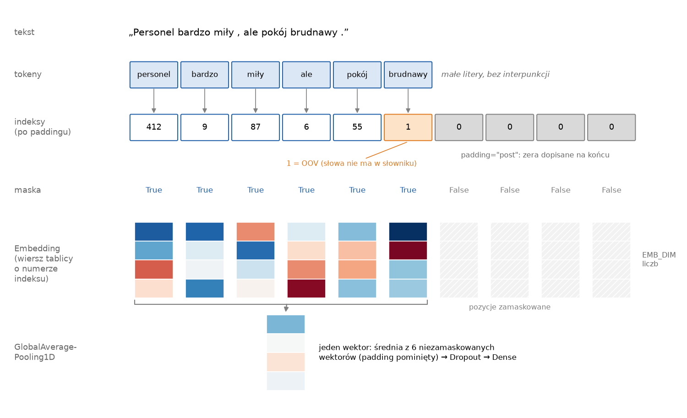
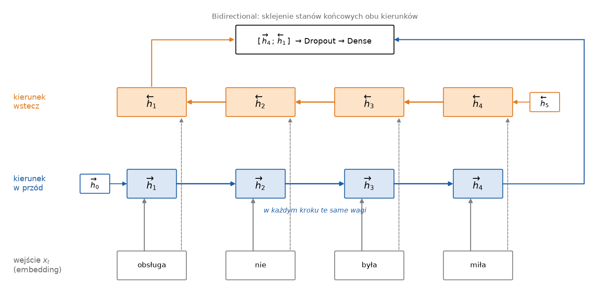
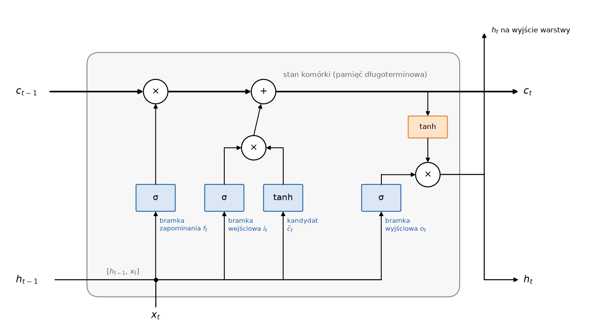
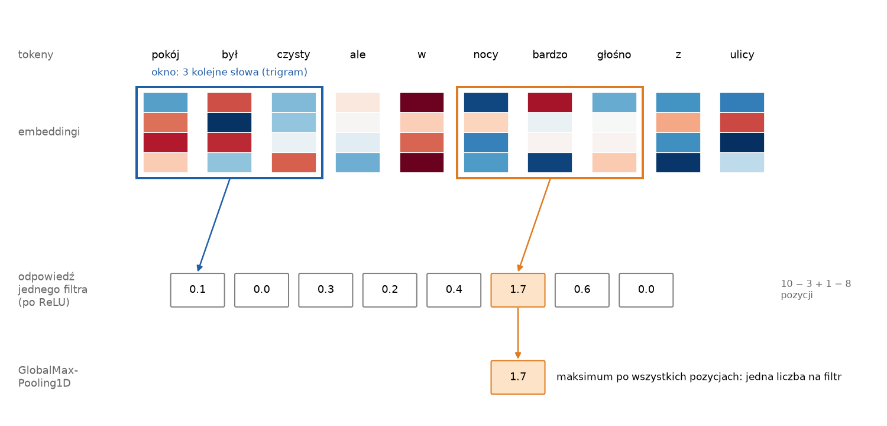

# Laboratorium 5: Sieci neuronowe w przetwarzaniu tekstu. Wprowadzenie

Ten tekst przeczytajcie przed zajęciami. Zbiera pojęcia potrzebne we wszystkich zadaniach, także rozszerzonych: od zamiany recenzji na ciąg liczb, przez warstwę Embedding, sieci rekurencyjne i splotowe, po ocenę modeli i zmianę domeny.

## PolEmo 2.0 i klasy wydźwięku

PolEmo 2.0 to korpus polskich recenzji z czterech dziedzin: medycyny, hoteli, produktów i szkoły. W wersji PolEmo 2.0-IN z benchmarku KLEJ wszystkie trzy zbiory pochodzą z tych samych dziedzin, medycyny i hoteli (5783 recenzje treningowe, 723 walidacyjne, 722 testowe). Każda recenzja ma jedną etykietę wydźwięku (sentiment): minus (negatywna), plus (pozytywna), amb (ambiwalentna, z argumentami za i przeciw) albo zero (neutralna, bez wyrażonej opinii). Klasy nie są równoliczne. Teksty są już podzielone spacjami na tokeny, stąd osobno stojące kropki i rozbite formy w rodzaju „Była m”, a część recenzji nie ma polskich znaków. To cecha danych, nie błąd wczytywania.

## Punkt odniesienia: TF-IDF i regresja logistyczna

Klasyczne podejście znacie z uczenia maszynowego, więc tylko przypomnienie. Dokument to wektor o długości słownika, w którym słowo lub bigram t ma wagę:

```
tfidf(t, d) = tf(t, d) * idf(t)
idf(t)      = ln((1 + n) / (1 + df(t))) + 1
sublinear_tf=True:  tf zastąpione przez 1 + ln(tf)
```

gdzie n to liczba dokumentów, a df(t) liczba dokumentów zawierających t. Na tej macierzy uczy się regresja logistyczna. Kolejność słów przepada, poza tym, co zachowają bigramy. Sieć musi z tym modelem wyraźnie wygrać, żeby jej złożoność była uzasadniona. Wektoryzator, tak jak później słownik sieci, dopasowuje się tylko na zbiorze treningowym.

## Tokenizacja, słownik i OOV

Sieć przyjmuje liczby całkowite, nie napisy. Najpierw tokenizacja (tokenization), czyli podział tekstu na jednostki, tutaj słowa: zamiana na małe litery i wyciągnięcie ciągów pasujących do `[a-ząćęłńóśźż0-9]+`. Interpunkcja znika.

Słownik (vocabulary) powstaje z liczników tokenów w zbiorze treningowym (`collections.Counter`): najczęstsze słowa dostają kolejne numery. Dwa indeksy są zarezerwowane. 0 oznacza padding, czyli brak słowa. 1 oznacza token spoza słownika (out of vocabulary, OOV) i trafia do niego każde słowo, którego nie ma wśród wybranych najczęstszych. Prawdziwe słowa mają indeksy od 2, a `MAX_TOKENS` obejmuje oba indeksy specjalne.

Polska fleksja sprawia, że „lekarz”, „lekarza” i „lekarzem” są dla tokenizera trzema różnymi słowami, każde z osobnym licznikiem i miejscem w słowniku. Pomyślcie o tym, licząc odsetek OOV na walidacji.

Keras ma warstwę `keras.layers.TextVectorization`, która standaryzuje tekst, dzieli go, buduje słownik (`adapt()`) i zamienia tokeny na indeksy, przy czym w trybie `output_mode="int"` też rezerwuje 0 na padding i 1 na OOV. Warstwa korzysta wewnętrznie z TensorFlow i jako część modelu działa tylko z tym backendem. W laboratorium 6 przejdziecie na backend torch, więc tokenizer i słownik piszecie sami w Pythonie.

## Padding, obcinanie i maska

Paczka (batch) musi być prostokątną macierzą. `keras.utils.pad_sequences` sprowadza sekwencje do długości `maxlen`: krótsze dopełnia zerami (padding), dłuższe obcina (truncating). Wartość `"pre"` działa na początku sekwencji, `"post"` na końcu, a domyślnie oba parametry mają `"pre"`, dlatego w notebooku podajecie `"post"` jawnie. `MAX_LEN` to kompromis między utratą końcówek długich recenzji a czasem obliczeń; wybiera się go z percentyli rozkładu długości.

Bez dodatkowej informacji sieć potraktowałaby zera jak zwykłe słowo. Tę informację niesie maska (mask): wartości `True` na pozycjach ze słowami i `False` na paddingu. `Embedding(..., mask_zero=True)` tworzy ją z indeksu 0 i przekazuje dalej, a warstwy obsługujące maskowanie, na przykład `GlobalAveragePooling1D` i `LSTM`, pomijają zamaskowane pozycje. Dlatego 0 nie może oznaczać żadnego prawdziwego tokenu, także OOV.



## Embedding jako tablica wektorów

`Embedding(input_dim, output_dim)` to tablica o `input_dim` wierszach i `output_dim` kolumnach. Indeks słowa wybiera wiersz, czyli gęsty wektor (embedding). Na początku wartości są losowe i uczą się z gradientu straty jak każde inne wagi. Sekwencja `MAX_LEN` indeksów staje się macierzą `MAX_LEN` na `EMB_DIM`. Każda komórka tablicy jest parametrem:

```
parametry Embedding = input_dim * output_dim
przykład: 10 000 słów, wymiar 64  ->  640 000 parametrów
```

Porównajcie to z resztą sieci w `summary()` i z liczbą recenzji treningowych. Rzadkie słowa występują w kilku przykładach, więc ich wiersze dostają niewiele aktualizacji.

Najprostsza reprezentacja całej recenzji to średnia embeddingów. `GlobalAveragePooling1D` z maską uśrednia tylko n prawdziwych tokenów:

```
v = (1 / n) * suma po t z maską True: e_t
```

Ten worek embeddingów, podobnie jak worek słów, nie zależy od kolejności: każda permutacja tych samych słów daje ten sam wektor v. Dalej są `Dropout` i `Dense(4, activation="softmax")`, a strata to `sparse_categorical_crossentropy`, bo etykiety są liczbami od 0 do 3.

## Sieci rekurencyjne i stan ukryty

Sieć rekurencyjna (recurrent neural network, RNN) czyta sekwencję słowo po słowie i przenosi między krokami stan ukryty (hidden state):

```
h_t = tanh(W * x_t + U * h_{t-1} + b)
```

W, U i b są te same w każdym kroku, więc liczba parametrów nie zależy od długości tekstu. Dolny wiersz stanów na rysunku to taka sieć rozwinięta w czasie (unrolled). Stan po ostatnim słowie trafia do klasyfikatora. Na pozycjach zamaskowanych stan nie jest aktualizowany, tylko przepisywany dalej.

Gradient wraca do wczesnych kroków przez iloczyn wielu pochodnych. Gdy czynniki są zwykle mniejsze od 1, zanika wykładniczo, gdy większe, eksploduje. To problem długich zależności (long-term dependencies): zwykła RNN słabo łączy słowa odległe o kilkadziesiąt pozycji.



## LSTM i bramki

LSTM (long short-term memory) dodaje stan komórki (cell state) c, który zmienia się głównie przez mnożenie po współrzędnych i dodawanie, więc informacja i gradient łatwiej przechodzą przez wiele kroków. Przepływem sterują bramki (gates), wektory z przedziału od 0 do 1:

```
f_t = sigmoid(W_f x_t + U_f h_{t-1} + b_f)      bramka zapominania
i_t = sigmoid(W_i x_t + U_i h_{t-1} + b_i)      bramka wejściowa
o_t = sigmoid(W_o x_t + U_o h_{t-1} + b_o)      bramka wyjściowa
g_t = tanh(W_g x_t + U_g h_{t-1} + b_g)         kandydat do zapisu
c_t = f_t * c_{t-1} + i_t * g_t                 (* po współrzędnych)
h_t = o_t * tanh(c_t)
parametry LSTM = 4 * (units * (d + units) + units),   d = EMB_DIM
```

Bramka zapominania decyduje, ile pamięci zostaje, wejściowa, ile nowej treści się dopisuje, a wyjściowa, co trafia do h_t. Gdy f_t jest bliskie 1, informacja przechodzi przez wiele słów prawie bez zmian.



Na GPU z backendem TensorFlow `keras.layers.LSTM` używa szybkiej implementacji cuDNN tylko przy `activation="tanh"`, `recurrent_activation="sigmoid"`, `recurrent_dropout=0`, `unroll=False` i `use_bias=True`. Według dokumentacji przy masce sekwencje muszą być dopełnione wyłącznie z prawej strony, czyli `padding="post"`. Stąd dropout w notebooku stoi za warstwą rekurencyjną.

## Bidirectional

`Bidirectional(LSTM(units))` tworzy dwie warstwy LSTM z osobnymi wagami: jedna czyta recenzję od początku, druga od końca. Przy domyślnym `merge_mode="concat"` ich stany końcowe są sklejane, więc wyjście ma długość 2 * units, a parametrów jest dwa razy więcej niż w pojedynczym LSTM. Zastanówcie się, które słowa najsilniej wpływają na stan końcowy każdego kierunku.

## Conv1D na tekście

`Conv1D` przesuwa okno wzdłuż sekwencji. Filtr o szerokości k obejmuje embeddingi k kolejnych słów i zwraca jedną liczbę, czyli reaguje na n-gram słów. Podobne słowa mają podobne embeddingi, więc podobne n-gramy dają podobną odpowiedź, a te same wagi działają w każdym miejscu tekstu. Przy domyślnym `padding="valid"`:

```
długość wyjścia = L - k + 1
parametry Conv1D = k * d * filters + filters
```

`GlobalMaxPooling1D` zostawia z odpowiedzi każdego filtra maksimum po pozycjach. Wiadomo więc, jak silnie wzorzec wystąpił w najlepszym miejscu, ale nie, gdzie. `GlobalAveragePooling1D` uśredniłby odpowiedzi ze wszystkich miejsc. Taki układ zaproponował dla klasyfikacji zdań Kim (2014). Na rysunku filtr ma szerokość 3, w notebooku 5.



`Conv1D` nie obsługuje maski, więc Embedding w tym modelu jej nie tworzy. Indeks 0 jest wtedy zwykłym wierszem tablicy z uczonym wektorem, a filtry widzą także okna z paddingiem.

## Ocena przy niezrównoważonych klasach

Accuracy przy nierównych klasach bywa wysoka nawet wtedy, gdy model prawie nie rozpoznaje małych klas, dlatego porównuje się ją z modelem, który zawsze odpowiada najliczniejszą klasą. Dla każdej klasy k liczy się:

```
precision_k = TP_k / (TP_k + FP_k)
recall_k    = TP_k / (TP_k + FN_k)
F1_k        = 2 * precision_k * recall_k / (precision_k + recall_k)
macro F1    = średnia F1_k po klasach, każda z tą samą wagą
```

W `f1_score` trzeba podać `average="macro"`, a `labels` ogranicza średnią do wybranych klas. Macierz pomyłek pokazuje, z czym myli się każda klasa.

Model wybiera się na walidacji; `EarlyStopping(monitor="val_loss", restore_best_weights=True)` przywraca wagi z najlepszej epoki. Test sprawdza się raz, na końcu, bo każda decyzja podjęta po jego obejrzeniu odbiera mu niezależność. Przy kilkuset przykładach przeliczcie różnicę wyników na liczbę recenzji, zanim uznacie ją za istotną.

## Sąsiedzi w przestrzeni embeddingów

Wiersze wytrenowanej tablicy Embedding to wektory słów. Wagi odczytuje się przez `keras.ops.convert_to_numpy(warstwa.embeddings)`, a podobieństwo mierzy kosinusem:

```
cos(a, b) = (a · b) / (||a|| * ||b||)
```

Długość wektora nie gra tu roli. Sąsiedzi słowa to słowa o największym kosinusie; szuka się ich wśród częstych słów, bo wektory rzadkich są bliskie losowym. W word2vec embeddingi uczy się na ogromnych korpusach z przewidywania sąsiednich słów. Tutaj jedynym sygnałem zmieniającym wektor słowa jest gradient straty klasyfikacji wydźwięku na kilku tysiącach recenzji. Interpretując sąsiadów, pytajcie, jakie podobieństwo ta strata nagradza.

W modelu z uśrednianiem Dropout przy predykcji jest wyłączony, a Dense przed softmaksem jest liniowa, więc wynik klasy to średnia wkładów słów:

```
z = W^T * (1/n) * suma e_t + b = (1/n) * suma (W^T * e_t) + b
```

Wkład słowa do klasy to iloczyn jego embeddingu z kolumną wag tej klasy. Odjęcie średniej z czterech klas pokazuje, w którą stronę słowo przesuwa decyzję.

## Zmiana domeny i PolEmo 2.0-OUT

PolEmo 2.0-OUT ma ten sam zbiór treningowy, ale test (494 recenzje) pochodzi z dziedzin, których model nie widział: recenzji produktów i opinii o zajęciach na uczelni. To zmiana domeny (domain shift). Modele ocenia się bez ponownego trenowania, z tym samym słownikiem i wektoryzatorem. Spadek wyniku ma dwa źródła. Jedno to inne słownictwo, widoczne choćby w odsetku OOV. Drugie to inny rozkład klas, który zmienia accuracy nawet przy niezmienionym recall każdej klasy. Ten drugi efekt da się policzyć:

```
accuracy_oczekiwana = suma po k: recall_IN(k) * n_OUT(k) / N_OUT
```

Różnica między tą wartością a accuracy zmierzoną na OUT to część spadku, której nie tłumaczy rozkład klas. Klasa z pojedynczymi przykładami w teście ma bardzo niestabilne F1 i psuje wiarygodność macro F1 po wszystkich klasach.

## Literatura i dokumentacja

- F. Chollet, Deep Learning with Python, 2. wydanie, Manning 2021: rozdział 11 (Deep learning for text).
- I. Goodfellow, Y. Bengio, A. Courville, Deep Learning, MIT Press 2016: rozdział 10 (Sequence Modeling: Recurrent and Recursive Nets) i podrozdział 12.4 (Natural Language Processing), https://www.deeplearningbook.org
- S. Hochreiter, J. Schmidhuber, Long Short-Term Memory, Neural Computation 9(8), 1997.
- Y. Kim, Convolutional Neural Networks for Sentence Classification, EMNLP 2014: https://aclanthology.org/D14-1181/
- J. Kocoń, P. Miłkowski, M. Zaśko-Zielińska, Multi-Level Sentiment Analysis of PolEmo 2.0: Extended Corpus of Multi-Domain Consumer Reviews, CoNLL 2019: https://aclanthology.org/K19-1092
- P. Rybak, R. Mroczkowski, J. Tracz, I. Gawlik, KLEJ: Comprehensive Benchmark for Polish Language Understanding, ACL 2020: https://aclanthology.org/2020.acl-main.111
- Zbiory na Hugging Face: https://huggingface.co/datasets/allegro/klej-polemo2-in i https://huggingface.co/datasets/allegro/klej-polemo2-out; strona benchmarku: https://klejbenchmark.com/tasks/
- Keras, Embedding: https://keras.io/api/layers/core_layers/embedding/
- Keras, LSTM (z warunkami użycia cuDNN): https://keras.io/api/layers/recurrent_layers/lstm/
- Keras, Bidirectional: https://keras.io/api/layers/recurrent_layers/bidirectional/
- Keras, Conv1D: https://keras.io/api/layers/convolution_layers/convolution1d/
- Keras, GlobalAveragePooling1D: https://keras.io/api/layers/pooling_layers/global_average_pooling1d/
- Keras, GlobalMaxPooling1D: https://keras.io/api/layers/pooling_layers/global_max_pooling1d/
- Keras, TextVectorization: https://keras.io/api/layers/preprocessing_layers/text/text_vectorization/
- scikit-learn, TfidfVectorizer: https://scikit-learn.org/stable/modules/generated/sklearn.feature_extraction.text.TfidfVectorizer.html
- scikit-learn, LogisticRegression: https://scikit-learn.org/stable/modules/generated/sklearn.linear_model.LogisticRegression.html
