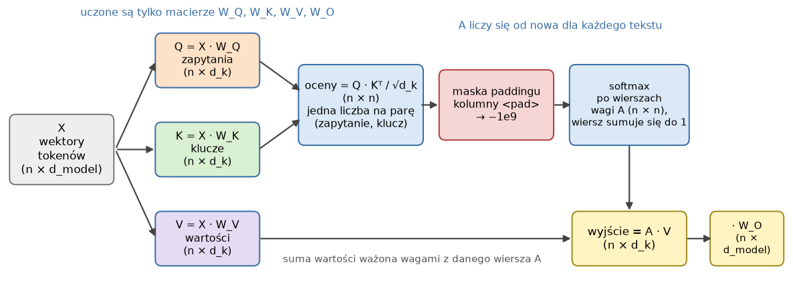
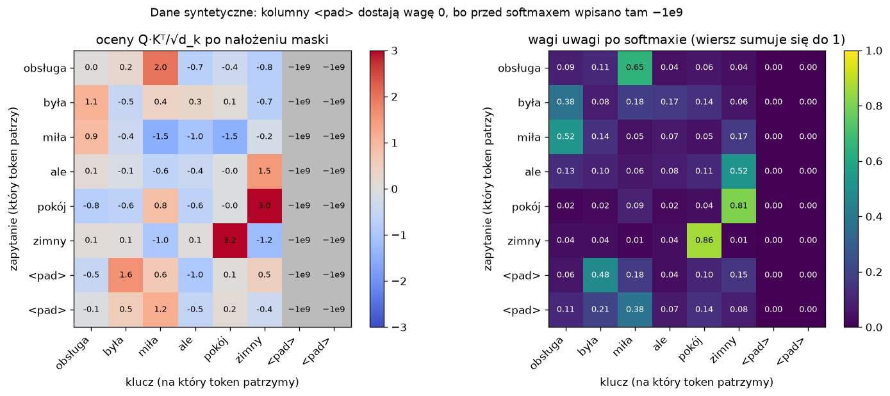
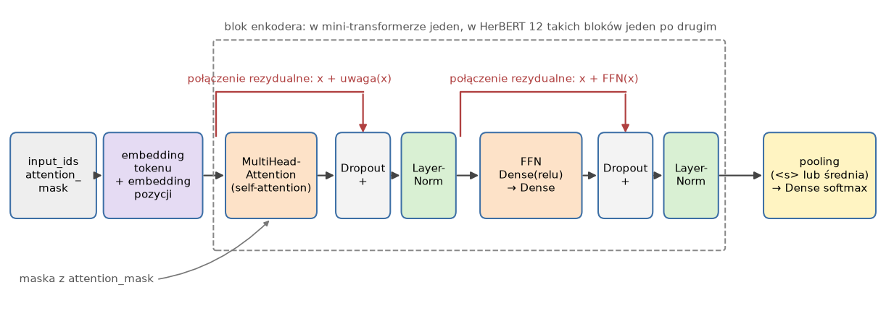
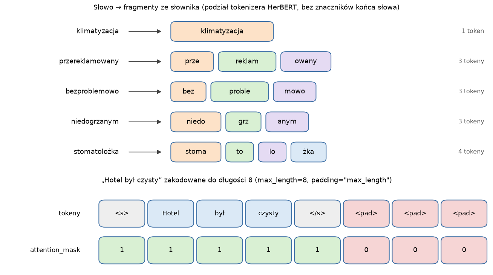

# Laboratorium 6: Mechanizm uwagi i transformery w przetwarzaniu tekstu. Wprowadzenie

Tekst jest do przeczytania przed zajęciami. Zbiera pojęcia, z których korzystają wszystkie zadania, także rozszerzone, i objaśnia, co robią funkcje i warstwy z notebooka. Na pytania z instrukcji odpowiecie sami, na podstawie własnych obliczeń.

## Od sieci rekurencyjnych do uwagi

W laboratorium 5 recenzje przetwarzała m.in. sieć BiLSTM. Sieć rekurencyjna (RNN) czyta tekst token po tokenie i całą wiedzę o przeczytanym fragmencie przenosi w jednym wektorze stanu. Obliczeń dla kolejnych pozycji nie da się więc zrównoleglić, bo krok t czeka na wynik kroku t-1. Poważniejszy kłopot dotyczy jakości: informacja o słowie sprzed stu tokenów musi przejść przez sto aktualizacji stanu, a gradient wraca tą samą drogą. Bramki LSTM łagodzą zanikanie gradientu, ale go nie usuwają.

Mechanizm uwagi (attention) pozwala każdemu tokenowi zajrzeć w jednym kroku do wszystkich pozostałych i samemu ocenić, które są dla niego ważne. Odległość między słowami nie wydłuża ścieżki, a wszystkie pozycje liczy się naraz, jednym mnożeniem macierzy. Transformer (Vaswani i in., 2017) składa się prawie wyłącznie z warstw uwagi i zwykłych warstw gęstych.

## Zapytania, klucze i wartości

Punktem wyjścia jest macierz X, w której każdy wiersz to wektor jednego tokenu o wymiarze d_model. Z X powstają trzy macierze:

```
Q = X · W_Q     zapytania (queries)
K = X · W_K     klucze (keys)
V = X · W_V     wartości (values)
```

Zapytanie opisuje, czego token szuka, klucz, czym token jest dla innych, a wartość to treść, którą przekaże, gdy ktoś na niego spojrzy. Dopasowanie zapytania i do klucza j mierzy ich iloczyn skalarny, a dla wszystkich par naraz powstaje macierz ocen n × n (n to liczba tokenów). Scaled dot-product attention to:

```
oceny = Q · K^T / sqrt(d_k)
A     = softmax(oceny)        osobno w każdym wierszu
wynik = A · V
```

Softmax po wierszach zamienia oceny jednego zapytania na nieujemne wagi sumujące się do 1, więc wynik dla tokenu i jest średnią ważoną wartości wszystkich tokenów. W implementacji od ocen odejmuje się maksimum w wierszu przed exp: wynik się nie zmienia, bo wspólny czynnik skraca się w liczniku i mianowniku, a nie grozi przepełnienie.



Dzielenie przez pierwiastek z d_k (wymiaru kluczy) wiąże się z zachowaniem softmaxu. Gdy oceny w wierszu bardzo się od siebie różnią, softmax oddaje prawie całą wagę jednemu kluczowi. Softmax uogólnia sigmoidę na wiele klas, więc przypomnijcie sobie, jak wygląda pochodna sigmoidy na jej płaskich brzegach. Jak rozrzut ocen zależy od d_k i co zmienia skalowanie, sprawdzicie w ostatnim kroku zadania 1.

Uczone są tu tylko macierze W_Q, W_K, W_V i macierz wyjściowa W_O, która rzutuje wynik z powrotem na wymiar d_model. Macierzy A model nie przechowuje: liczy ją od nowa dla każdego tekstu z jego własnych wektorów.

## Maska paddingu

Teksty w batchu muszą mieć jedną długość, więc krótsze dopełnia się tokenami paddingu. Bez dodatkowego zabiegu każdy token przypisałby im jakąś wagę, a ich wartości weszłyby do średniej. Maska paddingu działa przed softmaxem: w kolumnach paddingu wpisuje się bardzo małą liczbę (w notebooku -1e9), po exp zostaje tam praktycznie zero, a pozostałe wagi nadal sumują się do 1.



Liczby na rysunku są wymyślone. Wiersze, w których zapytaniem jest sam padding, też mają wagi, ale to nie szkodzi, bo pooling na końcu modelu pomija te pozycje dzięki tej samej masce.

## Self-attention, wiele głów i MultiHeadAttention w Keras

Gdy Q, K i V powstają z tej samej sekwencji, mówimy o self-attention. Jedna głowa (attention head) uczy się jednego sposobu dopasowywania tokenów. Uwaga wielogłowa (multi-head attention) liczy kilka głów równolegle, każdą z własnymi, mniejszymi macierzami W_Q, W_K, W_V, a ich wyniki skleja i mnoży przez W_O. HerBERT ma 12 głów po 64 wymiary, mini-transformer z zadania A cztery po 16.

W Keras robi to `keras.layers.MultiHeadAttention(num_heads, key_dim, ...)`. Wywołanie `mha(x, x)` to self-attention (query i value; key domyślnie równa się value). `attention_mask` to maska logiczna o kształcie (batch, liczba zapytań, liczba kluczy), w której 1 znaczy, że wolno patrzeć; maskę paddingu (batch, długość) rozszerza się do niej przez `maska[:, None, :]`. Z `return_attention_scores=True` warstwa zwraca też wagi. Jej własne wagi powstają przy pierwszym wywołaniu i mają osobną oś głów, więc przed `set_weights` sprawdźcie kształty w `get_weights()`.

## Kodowanie pozycji

Uwaga nie wie, w jakiej kolejności stoją tokeny. Po przestawieniu wierszy X wiersze wyniku przestawiają się tak samo, a ich wartości zostają te same. Kolejność trzeba więc dopisać do wektorów tokenów. W oryginalnym transformerze dodawano stałe wektory z funkcji sinus i cosinus, a BERT i HerBERT uczą osobnej tablicy embeddingów pozycji. Tak działa też gotowa warstwa `TokenyIPozycje`: do embeddingu tokenu dodaje embedding pozycji 0, 1, ..., `MAX_LEN - 1`. Pomyślcie przy okazji, skąd informację o kolejności bierze LSTM.

## Blok enkodera transformera

Blok enkodera ma dwie podwarstwy: self-attention z wieloma głowami i sieć feed-forward (FFN), czyli dwie warstwy gęste stosowane do każdej pozycji osobno, z nieliniowością pomiędzy (w mini-transformerze ReLU, w HerBERT GELU). Każdą otacza połączenie rezydualne (residual connection) i normalizacja warstwy (`LayerNormalization`):

```
x = LayerNorm(x + Dropout(MultiHeadAttention(x, x)))
x = LayerNorm(x + Dropout(FFN(x)))
```

Dzięki połączeniu rezydualnemu podwarstwa uczy się tylko poprawki do x, a gradient ma krótką drogę do wcześniejszych bloków. LayerNorm normalizuje wektor każdego tokenu osobno (po wymiarach cech, z uczoną skalą i przesunięciem), co stabilizuje trening. Wyjście bloku ma ten sam kształt co wejście, więc bloki układa się w stos. Na końcu z sekwencji wektorów trzeba zrobić jeden wektor recenzji; w zadaniu A robi to `GlobalAveragePooling1D` wywołana z maską.



Przy liczeniu parametrów przyda się reguła, że `Embedding(rozmiar_slownika, wymiar)` ma rozmiar_slownika · wymiar wag, a słownik HerBERT liczy 50 tys. tokenów.

## BERT, pretrening z maskowaniem i HerBERT

BERT (Devlin i in., 2019) to stos bloków enkodera, który najpierw uczy się języka na dużym korpusie bez etykiet. Główne zadanie pretreningu to modelowanie języka z maskowaniem (masked language modelling, MLM): część tokenów zastępuje się tokenem maski, a model odgaduje oryginał z kontekstu po obu stronach. Żeby to umieć, musi przyswoić składnię, odmianę i znaczenia słów. Dopiero potem dostraja się go do konkretnego zadania na małym zbiorze z etykietami.

HerBERT ma architekturę BERT i był trenowany na polskich korpusach (m.in. CCNet, Narodowy Korpus Języka Polskiego, Wikipedia, Wolne Lektury). Według karty modelu `allegro/herbert-base-cased` pretrening łączył MLM z maskowaniem całych słów i zadanie dotyczące struktury zdań (Sentence Structural Objective). Wersja base ma 12 bloków, wektory o wymiarze 768 i FFN o wymiarze 3072. Głów z pretreningu (wagi `cls.*`) nie używamy, dlatego transformers wypisuje je przy wczytaniu jako nieoczekiwane.

## Tokenizacja subword

W laboratorium 5 słownik składał się z całych słów, a każde słowo spoza niego stawało się tokenem OOV. W polszczyźnie każda forma odmiany to osobna pozycja takiego słownika. HerBERT używa tokenizacji subword opartej na BPE (byte-pair encoding, Sennrich i in., 2016). Uczenie tokenizera zaczyna się od pojedynczych znaków i raz po raz skleja najczęstszą w korpusie parę sąsiednich symboli w nowy symbol, aż słownik osiągnie zadany rozmiar (dla HerBERT 50 tys.). Częste słowa zostają pojedynczymi tokenami, rzadkie rozpadają się na częste fragmenty. Podział nowego słowa zależy więc od tego, co było częste w korpusie, na którym uczono tokenizer.



Podziały na rysunku zwrócił tokenizer HerBERT, ale bez znaczników, które dokleja do fragmentów; ich znaczenie zobaczycie w zadaniu 2. Tokeny specjalne to `<s>` na początku (odpowiednik `[CLS]` w BERT), `</s>` na końcu, `<pad>`, `<unk>` dla znaków, których nie da się złożyć ze słownika, i `<mask>` z pretreningu. `tokenizer(teksty, padding="max_length", truncation=True, max_length=MAX_LEN)` zwraca `input_ids` (indeksy tokenów) i `attention_mask` (1 dla tokenów, 0 dla paddingu), czyli maskę paddingu z poprzednich sekcji. Padding ma w HerBERT indeks 1, nie 0, więc `mask_zero=True` z laboratorium 5 tu nie pasuje.

## Długość sekwencji i MAX_LEN

HerBERT przyjmuje najwyżej 512 tokenów, a wszystkie recenzje przycina się lub dopełnia do długości `MAX_LEN`. Obcięcie (truncation) usuwa końcówkę tekstu, cokolwiek w niej było. Dłuższe sekwencje kosztują za to czas i pamięć, bo uwaga w każdej z 12 warstw liczy macierz n × n dla każdej głowy. Wybór `MAX_LEN` w zadaniu 2 opiera się więc na rozkładzie długości recenzji w tokenach: percentylach i odsetku tekstów dłuższych od progu. Ostrzeżenie tokenizera o tekstach dłuższych niż 512 tokenów przy samym liczeniu długości niczego nie psuje.

## Wektor całej recenzji

HerBERT zwraca wektor o wymiarze 768 dla każdego tokenu, a klasyfikator potrzebuje jednego na recenzję. W BERT służy do tego pierwszy token, `[CLS]` (w HerBERT `<s>`): przez uwagę jego wektor w ostatniej warstwie może zebrać informację z całego tekstu. Oryginalny BERT nakłada na niego jeszcze pooler, warstwę gęstą z tanh. Moduł `EnkoderHerBERT` wczytuje model z `add_pooling_layer=False` i zwraca surowy wektor `<s>` z ostatniej warstwy (`last_hidden_state[:, 0]`). Inna możliwość to średnia z wektorów prawdziwych tokenów:

```
średnia = suma_t( h_t · m_t ) / suma_t( m_t )      m_t = attention_mask w pozycji t
```

Obie reprezentacje porównacie w zadaniu B.

## Keras 3 na backendzie torch i TorchModuleWrapper

Laboratoria 1 do 5 działały na TensorFlow. Tu backendem jest PyTorch, bo transformers w wersji 5 nie obsługuje już TensorFlow, a HerBERT nie ma presetu w KerasHub. Backend ustala `os.environ["KERAS_BACKEND"] = "torch"` przed pierwszym `import keras` i w trakcie sesji nie da się go zmienić, stąd potrzeba świeżej sesji Colaba.

`keras.layers.TorchModuleWrapper` zamienia `torch.nn.Module` w warstwę Keras, której parametry Keras śledzi jak własne wagi; działa tylko na backendzie torch. HerBERT staje się dzięki temu zwykłą warstwą modelu funkcyjnego, a `model.fit` trenuje go razem z głową (`Dropout` i `Dense` z softmaxem). `output_shape` podpowiada Keras kształt wyjścia. Warstwa podaje modułowi jeden argument, dlatego wejścia przekazuje się jako listę `[input_ids, attention_mask]`, którą `forward` rozpakowuje.

## Fine-tuning

Fine-tuning (dostrajanie) to dalszy trening wszystkich wag modelu pretrenowanego na danych z naszego zadania. Punkt startowy jest inny niż przy treningu od zera: wagi enkodera są już dopasowane do języka, losowa jest tylko głowa. Learning rate jest wielokrotnie mniejszy niż domyślne 0,001 w Adam (`LR = 2e-5`), epok jest niewiele, a `EarlyStopping` pilnuje straty walidacyjnej. `keras.optimizers.AdamW` to Adam z rozdzielonym spadkiem wag (weight decay), typowy wybór przy modelach BERT. W notebooku learning rate jest stały. Często dodaje się rozgrzewkę (warmup), czyli stopniowe zwiększanie learning rate w pierwszych krokach (autorzy BERT w pretreningu zwiększali learning rate przez pierwsze 10 000 kroków), ale tutaj jej nie ma.

## Pamięć GPU, batch i czas

Na GPU muszą się zmieścić wagi, gradienty, stan optymalizatora (AdamW trzyma dla każdej wagi dwie średnie: gradientu i jego kwadratu) oraz aktywacje zapamiętane do propagacji wstecznej. Aktywacje rosną z rozmiarem batcha i z długością sekwencji, a są wśród nich macierze uwagi n × n dla każdej głowy w każdej warstwie. Przy braku pamięci zmniejsza się więc `BATCH` i buduje model od nowa. Z tego samego powodu notebook nie zapisuje modelu: plik z wagami i stanem optymalizatora jest ogromny. Czas predykcji jednej recenzji mierzy się po wywołaniu rozgrzewkowym, jako medianę kilku powtórzeń, bo pierwsze wywołanie bywa wolniejsze.

## HerBERT jako zamrożony ekstraktor cech

Można też nie ruszać wag HerBERT. Model przechodzi wtedy przez każdą recenzję raz, w trybie inferencji (`eval()` i `torch.no_grad()`), a wektory o wymiarze 768 trafiają jako cechy do regresji logistycznej ze standaryzacją. `wektory_herbert` sortuje teksty według długości, żeby w batchu było mniej paddingu. C i wariant reprezentacji wybiera się na walidacji, a test liczy się raz, dla wybranego modelu.

## Mini-transformer od zera

W zadaniu A te same tokeny HerBERT trafiają do małego transformera, którego wszystkie wagi, łącznie z embeddingami, startują losowo, a jedynym źródłem wiedzy o języku są recenzje treningowe. Porównanie z HerBERT oddziela wpływ architektury od wpływu pretreningu. Patrzcie na krzywe uczenia, zwłaszcza na rozjazd straty treningowej i walidacyjnej.

## Porównanie z laboratorium 5 i macro F1

Wyniki zestawia się na teście PolEmo 2.0-IN z TF-IDF + LR, Embedding + GAP, BiLSTM i Conv1D. Obok accuracy liczy się macro F1, zwykłą średnią z F1 dla każdej klasy:

```
F1_k     = 2 · precision_k · recall_k / (precision_k + recall_k)
macro F1 = (F1_minus + F1_plus + F1_amb + F1_zero) / 4
```

Każda klasa waży tyle samo niezależnie od liczności, więc słaby wynik na trudnej klasie amb (recenzje ambiwalentne) obniża macro F1 mocniej niż accuracy; szczegóły pokażą `classification_report` i macierz pomyłek. W tabeli są też liczba parametrów, czas treningu i czas predykcji, bo od nich również zależy wybór modelu. Test PolEmo 2.0-OUT (dla chętnych) zawiera recenzje z innych dziedzin. Klasa zero ma tam jedną recenzję, dlatego macro F1 liczy się dodatkowo dla trzech pozostałych klas.

## Literatura i dokumentacja

- A. Vaswani i in., Attention Is All You Need, NeurIPS 2017: https://arxiv.org/abs/1706.03762
- J. Devlin, M.-W. Chang, K. Lee, K. Toutanova, BERT: Pre-training of Deep Bidirectional Transformers for Language Understanding, NAACL 2019: https://aclanthology.org/N19-1423
- R. Mroczkowski, P. Rybak, A. Wróblewska, I. Gawlik, HerBERT: Efficiently Pretrained Transformer-based Language Model for Polish, BSNLP 2021: https://aclanthology.org/2021.bsnlp-1.1
- Karta modelu `allegro/herbert-base-cased` (korpusy, tokenizer, licencja): https://huggingface.co/allegro/herbert-base-cased
- R. Sennrich, B. Haddow, A. Birch, Neural Machine Translation of Rare Words with Subword Units, ACL 2016: https://aclanthology.org/P16-1162
- Hugging Face LLM Course, rozdział 6, Byte-Pair Encoding tokenization: https://huggingface.co/learn/llm-course/chapter6/5
- F. Chollet, Deep Learning with Python, 2. wydanie, Manning 2021: rozdział 11 (Deep learning for text), część o architekturze Transformer.
- I. Goodfellow, Y. Bengio, A. Courville, Deep Learning, MIT Press 2016: rozdział 10 (sieci rekurencyjne) i podrozdział 12.4 (przetwarzanie języka naturalnego), https://www.deeplearningbook.org
- Keras, MultiHeadAttention: https://keras.io/api/layers/attention_layers/multi_head_attention/
- Keras, TorchModuleWrapper: https://keras.io/api/layers/backend_specific_layers/torch_module_wrapper/
- Keras, LayerNormalization: https://keras.io/api/layers/normalization_layers/layer_normalization/
- Keras, GlobalAveragePooling1D: https://keras.io/api/layers/pooling_layers/global_average_pooling1d/
- Keras, AdamW: https://keras.io/api/optimizers/adamw/
- Keras, przykład Text classification with Transformer: https://keras.io/examples/nlp/text_classification_with_transformer/
- Dokumentacja transformers, HerBERT: https://huggingface.co/docs/transformers/model_doc/herbert
